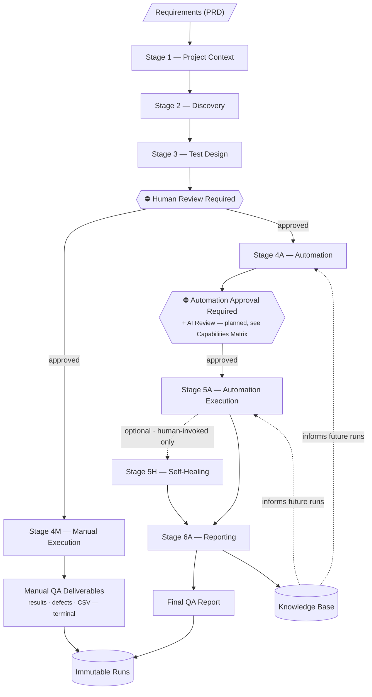
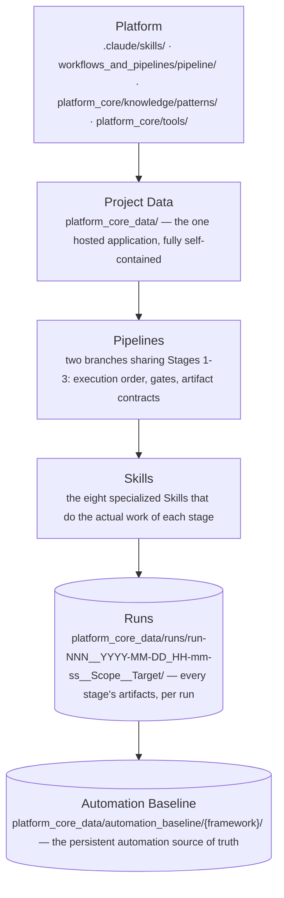
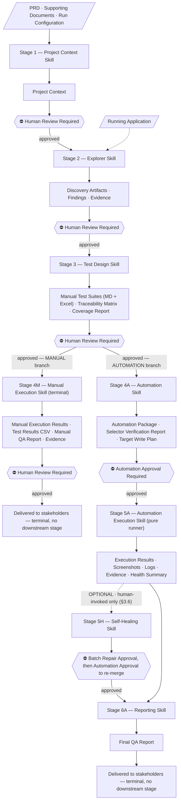
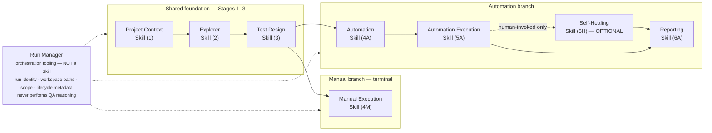
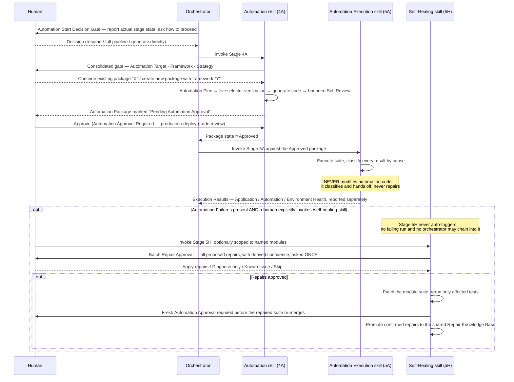
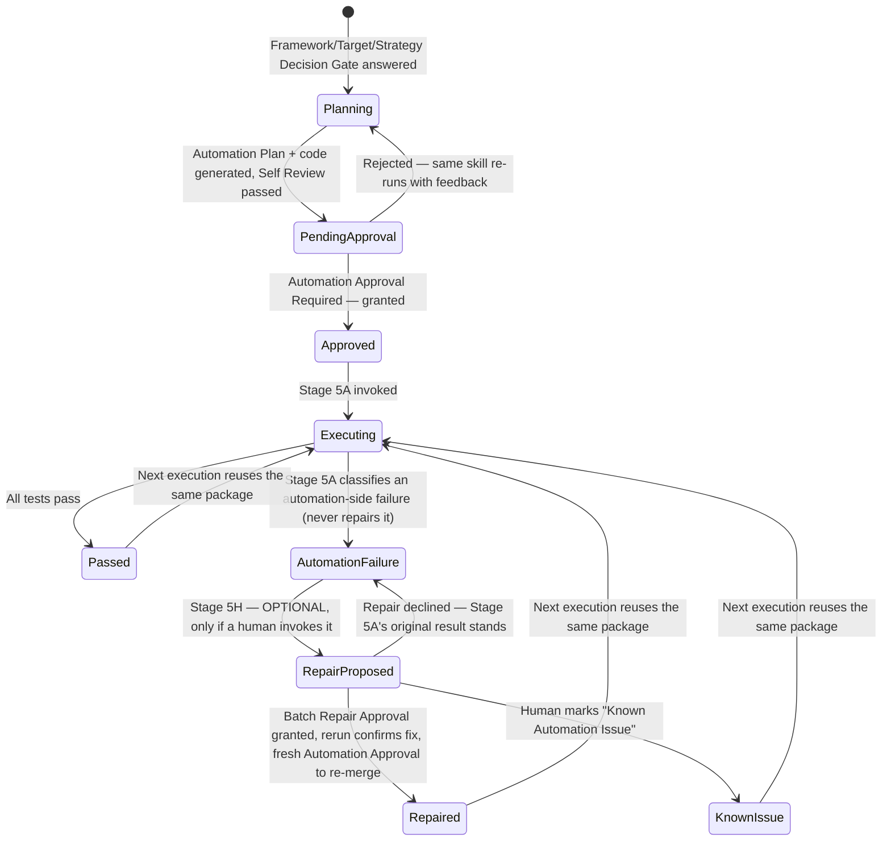
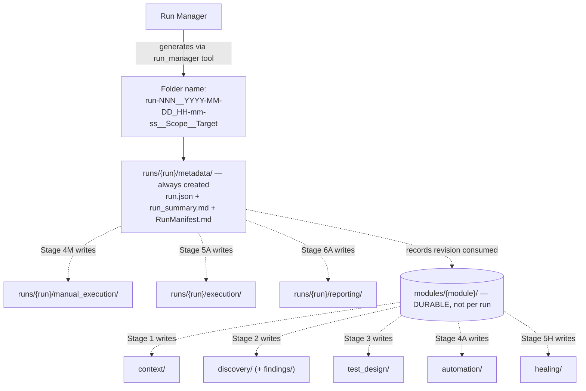
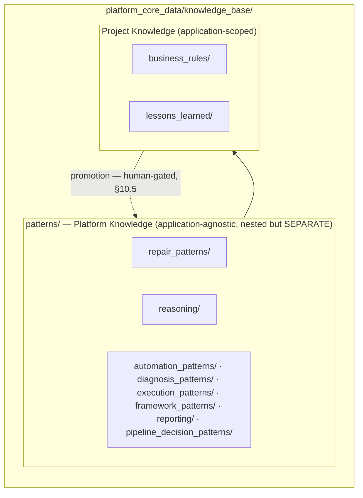
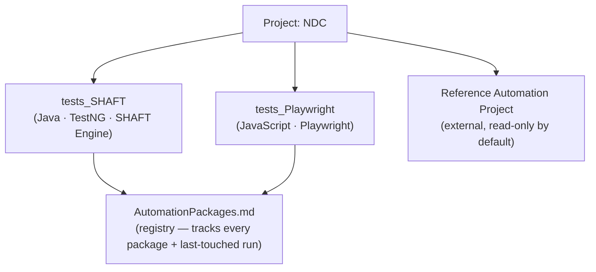

# Agentic AI Testing Platform

**Explore · Design · Validate · Automate · Execute · Report**

[](docs/CHANGELOG.md)
[](#7-skill-architecture)
[](#13-design-principles)
[](#16-quick-start)
[](#6-pipeline-architecture)
[](#1-project-overview)
[](#11-knowledge-base)
[](#6-pipeline-architecture)
[](docs/USER_GUIDE.md)

The Agentic AI Testing Platform is a multi-agent system that runs the complete software QA lifecycle — from an approved requirement to a delivered Final QA Report — as one governed, traceable pipeline. It exists to close the gap between conventional test automation tooling, which assumes test cases already exist, and the much larger problem most QA teams actually face: understanding an application, designing the right tests, generating automation that stays maintainable, and trusting the results enough to act on them. It's built for QA leads, test architects, and automation engineers who need enterprise-grade traceability and governance over the application they own — not simply a faster way to write scripts.

Where a traditional automation framework turns a fixed set of test cases into runnable code, this platform treats automation as one stage in a longer, artifact-driven chain: specialized AI agents explore the application, design test cases, generate automation, execute it, and report results, handing off a versioned artifact at every step. Every step that carries real risk — a document about to govern downstream work, code about to execute against a real environment — stops for explicit human approval. The result is a platform designed to get more reliable over time, not just faster: confirmed repairs and reusable engineering knowledge are captured once and applied automatically the next time a similar failure occurs.

---

## Vision

The long-term vision is an enterprise QA function where AI agents carry out the mechanical work — exploration, test design, automation, execution — while humans retain every decision that carries real business or technical risk. Automation quality should compound through a durable Knowledge Base instead of being rebuilt from scratch every engagement, and every one of those capabilities should stay fully auditable, one traceable artifact at a time. This is the direction the architecture is built toward — see [Current Project Status](#current-project-status) below for exactly how much of it is implemented today versus still in progress.

---

## Why This Platform

| Traditional Automation Framework | Agentic AI Testing Platform |
|---|---|
| Automation only | Complete QA lifecycle |
| Single script / suite | Multi-agent architecture |
| Manual context gathering | AI-generated Project Context |
| No traceability | Requirement-to-result traceability |
| Framework decides the process | Process decides the framework |
| Framework-centric | Knowledge-centric |
| Manual maintenance | Repair Knowledge Base |
| Static reports | Professional QA reports |

---

## Core Features

| | | |
|---|---|---|
| Multi-Agent Architecture | Single-Project Focus | Project Context |
| Run Scope | Knowledge Base | AI-Driven Discovery |
| Test Design | Automation Generation | Execution |
| Reporting | Repair Knowledge Base | Human Approval Workflow |
| Multi-Framework Support | | |

*Explained in full, with specifications, in the sections below.*

---

## Platform Highlights

| | |
|---|---|
| ✅ Enterprise Architecture | ✅ Knowledge Driven |
| ✅ Human Governed | ✅ Multi-Framework |
| ✅ Modular Design | ✅ End-to-End Traceability |
| ✅ Immutable Runs | ✅ AI Assisted |

---

## Current Project Status

| Area | Status |
|---|---|
| Repository Architecture | ✅ Stable |
| Documentation | ✅ Comprehensive |
| Platform Design (Agents, Pipeline, Knowledge Architecture) | ✅ Stable |
| Reference Project Validation (NDC) | ✅ Executed |
| Installable into any repository (`npx agentic-testing init`, brownfield + greenfield) | ✅ Complete |
| Deterministic Tooling Layer (beyond the Browser Driver) | 🚧 In Progress |
| Enterprise Integrations (ALM, Dashboards) | 📅 Planned |

*Status reflects platform specification and reference-project validation, not a hosted or packaged product release. See [§4 Platform Capabilities Matrix](#4-platform-capabilities-matrix) for a capability-by-capability breakdown.*

---

## Quick Navigation

[Overview](#1-project-overview) · [Architecture](#5-high-level-architecture) · [Pipeline](#6-pipeline-architecture) · [Skills](#7-skill-architecture) · [Repository](#9-repository-structure) · [Knowledge Base](#11-knowledge-base) · [Run Management](#10-run-architecture) · [Quick Start](#16-quick-start) · [Roadmap](#19-future-roadmap)

**New here?** [`docs/USER_GUIDE.md`](docs/USER_GUIDE.md) is the task-oriented walkthrough — install, inputs, running the pipeline, troubleshooting, CLI reference. This README is the architectural reference behind it.

The sections below are the platform's complete technical documentation — architecture, pipeline, skills, and full operational detail.

---

## Table of Contents

1. [Project Overview](#1-project-overview)
2. [Key Features](#2-key-features)
3. [End-to-End Platform Overview](#3-end-to-end-platform-overview)
4. [Platform Capabilities Matrix](#4-platform-capabilities-matrix)
5. [High-Level Architecture](#5-high-level-architecture)
6. [Pipeline Architecture](#6-pipeline-architecture)
7. [Skill Architecture](#7-skill-architecture)
8. [Automation Package Lifecycle](#8-automation-package-lifecycle)
9. [Repository Structure](#9-repository-structure)
10. [Run Architecture](#10-run-architecture)
10A. [Execution Safety](#10a-execution-safety)
10B. [Run Observability](#10b-run-observability)
11. [Knowledge Base](#11-knowledge-base)
12. [Multi-Framework Architecture](#12-multi-framework-architecture)
13. [Design Principles](#13-design-principles)
14. [Architecture Decision Records](#14-architecture-decision-records)
15. [Technology Stack](#15-technology-stack)
16. [Quick Start](#16-quick-start)
17. [Getting Started](#17-getting-started)
18. [Documentation Map](#18-documentation-map)
19. [Future Roadmap](#19-future-roadmap)

---

## 1. Project Overview

Most automation frameworks solve one problem: turning a known set of test cases into runnable scripts. They assume the requirements are already understood, the test cases are already written, and a human will read the results.

The Agentic AI Testing Platform is built around a different premise: the entire QA lifecycle — from "what does this application need to do" through "did it actually do it" — can be modeled as a chain of specialized AI agents that each own exactly one stage of that lifecycle, hand off their work through versioned artifacts, and stop at defined checkpoints for a human to approve before anything downstream depends on it.

Concretely, the platform:

- Turns an approved requirements document (PRD) into a scoped **Project Context** for a specific run.
- **Explores** the live application (or falls back to documentation, recordings, or user-guided exploration when a live app isn't available) and produces evidence-backed Discovery Artifacts.
- **Designs** manual test cases and a full requirement-traceability matrix from that context.
- **Generates** maintainable automation — reusing existing automation before writing new code, and supporting multiple frameworks side by side.
- **Executes** that automation, separating failures caused by the application, the automation, or the environment.
- **Reports** a QA assessment that a stakeholder can act on, with every claim traceable back to a requirement.

### Business value

- **Traceability by construction.** Every test case, automation script, and execution result carries a citation back to the requirement it covers — not because someone remembered to fill in a spreadsheet column, but because the pipeline's artifact contracts require it.
- **Governed, not autonomous.** The platform is AI-*assisted*. Every stage that produces a document or authorizes code execution stops at a named checkpoint until a human with the right role signs off — see §5.5 of [`workflows_and_pipelines/pipeline/pipeline.md`](workflows_and_pipelines/pipeline/pipeline.md) for exactly which decisions are reserved for a human versus made automatically.
- **Compounding, not repeating.** Repair strategies that are confirmed to work are captured in a versioned Knowledge Base and reused on the next failure with the same signature — instead of every run re-diagnosing the same class of problem from zero.
- **Single project, cleanly separated.** The hosted application is fully self-contained under `platform_core_data/`, and nothing application-specific lives outside it — so the same eight Skills and one pipeline specification apply unchanged when the platform is retargeted at a different application, with no code changes.

### Philosophy of AI-assisted testing

The platform is built on one recurring architectural pattern, repeated at every layer: **separate defining from validating, and separate producing from judging.**

- Requirements are *defined* in the PRD and *validated* (never redefined) by the Explorer skill against the live application — a documented discrepancy is a **Gap**, resolved by a human, never silently overwritten by what was observed ([Lessons Learned §1](docs/LESSONS_LEARNED.md)).
- Test results are *produced* mechanically by the Automation Execution skill and *judged* separately by the Reporting skill — no single stage both runs a test and writes the narrative conclusion about it ([Lessons Learned §2](docs/LESSONS_LEARNED.md)).
- Every gate that can accept a wrong *document* (Stages 1–3, `4M`) is deliberately weaker than the gate that authorizes *code to execute* against a real environment (`4A`, and any `5H` re-merge) — because the blast radius of the two failure modes is not the same ([Lessons Learned §3](docs/LESSONS_LEARNED.md)).

This is why the platform reads as "a pipeline with agents inside it," not "an agent with tools attached" — the discipline lives in the artifact contracts and checkpoints between stages, not in any single agent's judgment.

---

## 2. Key Features

| Feature | What it does | Where it's specified |
|---|---|---|
| **AI-Driven Discovery** | Explores a live application (or falls back through screenshots, recordings, user-guided exploration, documentation, or APIs) and produces evidence-backed findings, never inventing requirements | [`.claude/skills/explorer-skill/SKILL.md`](.claude/skills/explorer-skill/SKILL.md) |
| **Test Design Generation** | Derives manual test cases and a full traceability matrix from the approved Project Context, using Discovery only to validate/enrich | [`.claude/skills/test-design-skill/SKILL.md`](.claude/skills/test-design-skill/SKILL.md) |
| **Manual Execution & Reporting** (`4M`, terminal) | Executes the approved manual test suite against the live application **headed**, records results with full defect write-ups and evidence, then self-reports a stakeholder QA Report and a Test Results CSV. Produces no scripts | [`.claude/skills/manual-execution-skill/SKILL.md`](.claude/skills/manual-execution-skill/SKILL.md) |
| **Automation Generation** (`4A`) | Produces a production-quality, maintainable automation project — never a bag of isolated scripts — scoped directly from the approved test design, with **every selector verified live and headless** before it is emitted, both shared knowledge bases consulted first, and a bounded self-review pass | [`.claude/skills/automation-skill/SKILL.md`](.claude/skills/automation-skill/SKILL.md) |
| **Multi-Package, Multi-Framework Automation** | A project can hold several independent Automation Packages side by side (e.g. SHAFT and Playwright for the same application), each tracked in its own registry entry | [§8](#8-automation-package-lifecycle), [§12](#12-multi-framework-architecture) |
| **Self-Healing: Repair Reasoning + Confidence Engine** (`5H`, optional) | Diagnoses automation-side failures, proposes evidence-derived repair strategies with a **derived** percentage confidence, applies only human-approved repairs, reruns only what was repaired, and quarantines rather than repairing indefinitely. **Never heals an application defect** | [`.claude/skills/self-healing-skill/SKILL.md`](.claude/skills/self-healing-skill/SKILL.md) |
| **Live Selector Verification** (`4A`) | Every emitted locator is confirmed to resolve against the running application, headless, at generation time — with its fallback chain and code-state anchor recorded to a knowledge base **both** pipelines read | [`.claude/skills/automation-skill/SKILL.md` §11A](.claude/skills/automation-skill/SKILL.md) |
| **Two-Layer Knowledge Architecture** | Reusable engineering knowledge (Platform Knowledge) is kept separate from application-specific knowledge (Project Knowledge), merged automatically, promoted only by explicit human approval | [§11](#11-knowledge-base), [`workflows_and_pipelines/pipeline/pipeline.md` §10](workflows_and_pipelines/pipeline/pipeline.md) |
| **Human Approval Workflow** | Two distinct gate types — "Human Review Required" for documents, "Automation Approval Required" for code about to execute — plus an explicit Human-vs-Engineering decision boundary so approval isn't requested for routine engineering calls | [`workflows_and_pipelines/pipeline/pipeline.md` §5](workflows_and_pipelines/pipeline/pipeline.md) |
| **Self-Descriptive Run Management** | Every execution gets a deterministic, self-descriptive folder name (`run-NNN__YYYY-MM-DD_HH-mm-ss__Scope__Target`), generated by a single reusable utility, an on-demand-built workspace, structured metadata, and a factual run summary — with no judgment role of its own | [`workflows_and_pipelines/pipeline/run_manager.md`](workflows_and_pipelines/pipeline/run_manager.md) |
| **Run Scope** | Every run declares exactly what it's allowed to validate — Entire Project, Epic, Feature, User Story, Bug, Requirement Document, or Custom Scope | [`workflows_and_pipelines/pipeline/run_scope.md`](workflows_and_pipelines/pipeline/run_scope.md) |
| **Reference Automation Project Support** | A project can register an external, human-owned automation codebase as a reference — read-only by default, with an explicit gate before any write to it | [`.claude/skills/automation-skill/SKILL.md` §32](.claude/skills/automation-skill/SKILL.md) |
| **Browser Driver Layer** | A single shared engine (`platform_core/tools/browser_driver/`) drives every authenticated browser session, with credentials always outside the repo's tracked history | [`platform_core/tools/browser_driver/README.md`](platform_core/tools/browser_driver/README.md) |
| **Reporting** | A Final QA Report that computes Requirement Coverage and Automation Coverage by walking the full traceability chain, not by re-asserting the Automation Execution skill's raw output | [`.claude/skills/reporting-skill/SKILL.md`](.claude/skills/reporting-skill/SKILL.md) |
| **One Shared HTML Report Design** | Every pipeline report — Discovery, Coverage, Automation Coverage/Decision, Manual QA, Execution Results, Repair Summary, Final QA Report — renders through one shared HTML design, generated alongside (never in place of) the authoritative Markdown | [`platform_core/tools/report_builder/README.md`](platform_core/tools/report_builder/README.md), [`workflows_and_pipelines/pipeline/pipeline.md` §17](workflows_and_pipelines/pipeline/pipeline.md) |
| **Execution Analysis** | Application Health, Automation Health, and Environment Health are always reported as three separate figures — never one merged "Failed" count. This separation is what makes self-healing safe: only `Automation Failure` is ever eligible for repair | [`.claude/skills/automation-execution-skill/SKILL.md` §25.2](.claude/skills/automation-execution-skill/SKILL.md) |

---

## 3. End-to-End Platform Overview

The entire platform, at a glance — read top to bottom:



A **Requirement** becomes a scoped **Project Context**, which drives **Discovery** of the real application, which grounds **Test Design**. Test Design is the **divergence point**: its approved output is the sole scope-determining input for **two independent branches**. The **Manual** branch executes the suite by hand and self-reports its own QA deliverables — it is terminal, and it never feeds Automation. The **Automation** branch generates a suite (grounding correctness in live selector verification, not in a prior manual pass), clears an **Automation Approval Gate** before any generated code executes, runs it, optionally repairs it via human-invoked **Self-Healing**, and **Reports** a stakeholder-facing QA assessment. Either branch may run alone, in either order, or both. Every confirmed repair or lesson feeds the **Knowledge Base** — which in turn informs the *next* run's Automation and Execution stages, rather than starting from zero. Durable design output lives per module; every execution is preserved forever as an **Immutable Run**.

This is the same flow detailed stage-by-stage in [§6 Pipeline Architecture](#6-pipeline-architecture) — this diagram exists so a new engineer can hold the whole system in their head before reading any further.

---

## 4. Platform Capabilities Matrix

A capability listed here as *Implemented* has a written agent/pipeline specification **and** has been exercised on a real onboarded project (evidence: NDC's executed runs, generated automation packages, and Repair Knowledge Base entries). *Designed* means a specification exists but no project has exercised it yet. *Planned* means it is a named direction with no implementation specification yet — see [§19 Future Roadmap](#19-future-roadmap).

| Capability | Status | Notes |
|---|---|---|
| Discovery (browser automation + documented fallback chain) | ✅ Implemented | [`.claude/skills/explorer-skill/SKILL.md`](.claude/skills/explorer-skill/SKILL.md) |
| Test Design Generation | ✅ Implemented | [`.claude/skills/test-design-skill/SKILL.md`](.claude/skills/test-design-skill/SKILL.md) |
| Manual Execution & Reporting (`4M`) | ✅ Implemented | [`.claude/skills/manual-execution-skill/SKILL.md`](.claude/skills/manual-execution-skill/SKILL.md) |
| Self-Healing (`5H`, optional) | ✅ Implemented | [`.claude/skills/self-healing-skill/SKILL.md`](.claude/skills/self-healing-skill/SKILL.md) |
| Automation Generation (multi-framework, multi-package) | ✅ Implemented | [`.claude/skills/automation-skill/SKILL.md`](.claude/skills/automation-skill/SKILL.md) |
| Execution | ✅ Implemented | [`.claude/skills/automation-execution-skill/SKILL.md`](.claude/skills/automation-execution-skill/SKILL.md) |
| Reporting | ✅ Implemented | [`.claude/skills/reporting-skill/SKILL.md`](.claude/skills/reporting-skill/SKILL.md) |
| Human Approval Workflow (two gate types) | ✅ Implemented | [`workflows_and_pipelines/pipeline/pipeline.md` §5](workflows_and_pipelines/pipeline/pipeline.md) |
| Automation Package Lifecycle (registry, decision gates, repair states) | ✅ Implemented | [§8](#8-automation-package-lifecycle) |
| Self-Healing: Repair Reasoning + Confidence Engine | ✅ Implemented | [`.claude/skills/self-healing-skill/SKILL.md`](.claude/skills/self-healing-skill/SKILL.md) |
| Live Selector Verification | ✅ Implemented | [`.claude/skills/automation-skill/SKILL.md` §11A](.claude/skills/automation-skill/SKILL.md) |
| Two-Layer Knowledge Architecture | ✅ Implemented | [§11](#11-knowledge-base) |
| Intelligent Run Management | ✅ Implemented | [`workflows_and_pipelines/pipeline/run_manager.md`](workflows_and_pipelines/pipeline/run_manager.md) |
| Reference Automation Project support | ✅ Implemented | [`.claude/skills/automation-skill/SKILL.md` §32](.claude/skills/automation-skill/SKILL.md) |
| Browser Driver Layer | ✅ Implemented | [`platform_core/tools/browser_driver/README.md`](platform_core/tools/browser_driver/README.md) |
| MCP Tools Layer (`playwright` 2nd browser mode, `context7` stack docs) | ✅ Implemented | [`platform_core/tools/mcp/README.md`](platform_core/tools/mcp/README.md) |
| One Shared HTML Report Design | ✅ Implemented | [`platform_core/tools/report_builder/README.md`](platform_core/tools/report_builder/README.md) |
| Execution Safety Policy Evaluation | ✅ Implemented | [§10A](#10a-execution-safety) |
| Run Observability | ✅ Implemented | [§10B](#10b-run-observability) |
| Supplier Features (Import Booked PNR — the only registered Feature today) | ✅ Implemented | [`workflows_and_pipelines/pipeline/module_architecture.md` §11](workflows_and_pipelines/pipeline/module_architecture.md), [`ndc_execution_rules.md`](workflows_and_pipelines/pipeline/ndc_execution_rules.md) |
| Multi-Framework Support — SHAFT + Playwright, side by side | ✅ Implemented | [§12](#12-multi-framework-architecture) |
| Additional Frameworks — Selenium / Cypress / Appium / REST Assured | 🚧 Designed | Already named as first-class options in the Framework Decision Gate; no project has selected one yet |
| Non-Web Automation — API / Mobile / Desktop / Microservices / Batch / Cloud | 🚧 Designed | [`.claude/skills/automation-skill/SKILL.md` §29](.claude/skills/automation-skill/SKILL.md) — abstractions extend without redesign, not yet exercised for a real target |
| AI Review (dedicated automated code-review pass) | 📅 Planned | Distinct from today's implemented Automation skill Self Review; see Future Roadmap |
| Self-Healing Automation (autonomous repair) | 📅 Planned | Extends today's human-gated Repair Loop |
| Video → Automation | 📅 Planned | |
| Regression Intelligence / Impact Analysis | 📅 Planned | |
| ALM Integration — Azure DevOps / Jira / TestRail / Xray | 📅 Planned | [`workflows_and_pipelines/pipeline/run_scope.md`](workflows_and_pipelines/pipeline/run_scope.md) already names these as future Run Scope Sources |
| Enterprise Dashboard / Consolidated Run Index | 📅 Planned | |

---

## 5. High-Level Architecture

The platform is organized as five concentric layers. Reusable engineering logic lives at the top; the hosted project's history of runs lives at the bottom.



Reading this top to bottom: the **Platform** defines reusable rules that hold whatever application is under test. **Project Data** is those rules applied to the one real application currently hosted. The **Pipeline** is the fixed sequence those rules run in. The **Skills** are the workers that actually execute each stage. **Runs** are where every stage writes its artifacts — one folder per run, holding that run's complete output (cylinder = data store, consistent with [§3](#3-end-to-end-platform-overview) and [§11](#11-knowledge-base)). The **Automation Baseline** is the one thing that deliberately outlives a single run: generated automation *code*, merged out of a run's working copy into a persistent, lifecycle-managed baseline.

---

## 6. Pipeline Architecture

**Two pipelines share their first three stages and then diverge completely.** Each stage consumes only artifacts explicitly declared as its input — never a peer stage's internal reasoning — and every checkpoint stops the pipeline until a human with the right role approves.

| Pipeline | Stages | Delivers | Generates scripts? |
|---|---|---|---|
| **Manual Execution** | 1 → 2 → 3 → `4M` | Results, defect records, Test Results CSV, Manual QA Report, evidence | **never** |
| **Automation** | 1 → 2 → 3 → `4A` → `5A` → *(optional)* `5H` → `6A` | Automation suite, execution results, repairs, Final QA Report | yes |

**Branch isolation is load-bearing** (`pipeline.md` §3.3): neither branch reads any artifact the other produces, and either may run alone, in either order, or both. Automation does **not** wait on a manual pass — it grounds its correctness in live selector verification against the build the suite will actually run on, which is stronger and more current evidence.

**Stage `5H` (Self-Healing) never runs automatically** (§3.6). No failing execution triggers it and no orchestrator may chain into it; it runs only when a human invokes it, optionally scoped to named modules.



Manual Execution (`4M`) and Automation (`4A`) both branch from the **same** approved Stage 3 output. There is deliberately no edge from `4M` to `4A`: approving the Manual deliverable releases it to stakeholders and authorizes nothing downstream, because the Manual branch has none.

### Stage summary

| Stage | Skill | Input | Output | Checkpoint |
|---|---|---|---|---|
| 1 | Project Context skill | PRD, Supporting Documents, Run Configuration | Project Context | Human Review Required |
| 2 | Explorer skill | Project Context, Running Application | Discovery Artifacts, Findings, Evidence | Human Review Required |
| 3 | Test Design skill | Project Context (primary), Discovery Artifacts (secondary) | Manual Test Suites, Traceability Matrix, Coverage Report | Human Review Required |
| `4M` | Manual Execution skill *(Manual branch, terminal)* | Approved Manual Test Suites, Traceability Matrix, Coverage Report, Project Context | Manual Execution Results, Test Results CSV, Manual QA Report, Evidence | Human Review Required *(terminal — approving releases the delivery)* |
| `4A` | Automation skill *(Automation branch)* | Approved Manual Test Suites (**scope and content**), Traceability Matrix, Coverage Report, Project Context, Discovery, both shared KBs | Automation Package, Selector Verification Report, Target Write Plan, Self Review Report | Automation Approval Required |
| `5A` | Automation Execution skill *(pure mechanical runner)* | Approved Automation Package | Execution Results, Evidence, Metadata, three separated Health figures | None — mechanical run, already gated at `4A` |
| `5H` | Self-Healing skill *(**optional**, human-invoked only)* | Execution Results with ≥1 Automation Failure, Automation Suite, Repair KB | Repair Summary, Before/After Comparison, Quarantine Register, repaired suite | Batch Repair Approval (§5.6), then Automation Approval to re-merge |
| `6A` | Reporting skill *(Automation branch, terminal)* | Execution Results, Traceability Matrix, Project Context, Repair Summary (if `5H` ran) | Final QA Report | None — terminal stage |

Full specification, including every rule governing gate mechanics and rejection handling: [`workflows_and_pipelines/pipeline/pipeline.md`](workflows_and_pipelines/pipeline/pipeline.md).

### Why two gate types, not one

Approving a document (Stages 1–3, `4M`) risks a wrong document reaching the next stage. Approving `4A` authorizes **generated code to execute against a real environment** — a materially larger blast radius (data mutation, destructive actions, credential use). The pipeline treats "Automation Approval Required" as at least as strict as a production deployment approval, never as a lighter variant of document review.

A third gate, **Batch Repair Approval** (§5.6), exists solely for Stage `5H` — the only stage that modifies code a human already approved. It is asked **once per healing pass, never per test case**, and it can never authorize "healing" a genuine application defect: repairs may change how a test *interacts* with the application (locators, waits, setup), never *what it asserts to be correct*.

### The per-case lifecycle gate — `Review` and `Automation` (added 2026-08-01)

Stage-level approval says "this suite is good." It does not say *which cases in it a human has actually signed off on*. Every test case therefore carries **two lifecycle columns**, both `Pending` | `Approved` | `Rejected` and both defaulting to `Pending` ([`pipeline.md` §4 Stage 3](workflows_and_pipelines/pipeline/pipeline.md), `test-design-skill` §6.3):

| Column | Gates | Meaning of `Rejected` |
|---|---|---|
| `Review` | **both branches** — `4M` and `4A` | the case itself is not agreed; nobody runs it |
| `Automation` | the Automation branch only | the case stays **manual by decision** — not an automation coverage gap |

- Stage `4M` executes a case only when `Review = Approved`. Stage `4A` generates for a case only when `Review = Approved` **and** `Automation = Approved`.
- **Stage 3 always writes `Pending`, and no stage may ever change either value** — only a human reviewer may.
- Executing an unreviewed case makes its failure uninterpretable: it cannot distinguish *the application is wrong* from *the test case is wrong*, which is the only thing an execution result exists to establish. `4M` therefore reports **two denominators separately** (Executable scope / Suite total) plus an Authorized Coverage metric, adds a seventh Result Classification **`Excluded`** (reason mandatory, distinct from `Skipped`), and **halts rather than reporting "0 executed, 0 failures"** when no case is approved.

**Reviewing happens in the workbook, and the decisions flow back.** Content is derived one way — Markdown → Excel — but the two lifecycle columns are the one thing a human authors *after* generation, so they travel back the other way:

```bash
# BEFORE any re-export or Stage 4A: pull the reviewer's Review/Automation decisions
# out of the .xlsx and into the authored Markdown
node platform_core/tools/test_suite_export/cli.js --import-lifecycle
node platform_core/tools/test_suite_export/cli.js --import-lifecycle --check   # dry run
```

Only `Review` and `Automation` are imported. A Title edited in the workbook is still discarded — that is derived content. **Skipping this step silently destroys the reviewer's decisions**, because an export regenerates the sheet from the Markdown.

### Only Stage 1 reads the PRD

No other stage's input list contains the PRD. Once Stage 1's Project Context is approved, every downstream stage treats it — not the original requirements document — as the single source of truth for "what should the product do."

### Human decisions vs. engineering decisions

Not every judgment call inside a stage requires stopping to ask. The pipeline draws this line explicitly ([`workflows_and_pipelines/pipeline/pipeline.md` §5.5](workflows_and_pipelines/pipeline/pipeline.md)):

- **Always ask a human:** which automation framework to use, whether to continue an existing package or start a new one, which project/repository to target, environment selection when more than one exists, any destructive or irreversible operation, and any change to the run's actual business objective.
- **Make the call and keep moving, never pause to ask:** adding security/boundary/negative test cases during test design, marking a scenario `Deferred` when the current environment can't safely run it, risk annotations and coverage-gap documentation, and whether an adjacent unrequested feature stays out of the current run's scope.

---

## 7. Skill Architecture

Each of the eight skills has exactly one responsibility and communicates with its neighbors only through the artifacts defined in [§6](#6-pipeline-architecture). The **Run Manager** sits outside this pipeline entirely — it is orchestration tooling, never a judgment-making stage.

Each is invokable in pipeline order, or **directly by name** with an optional instruction prompt — see [`docs/USER_GUIDE.md` §6](docs/USER_GUIDE.md#6-calling-a-single-skill-directly) for the approve-and-recommend and degraded-run semantics that govern an out-of-order call.

| Component | Responsibility | Never does |
|---|---|---|
| [Run Manager](workflows_and_pipelines/pipeline/run_manager.md) | Allocates a Run ID, prepares the run workspace, tracks mechanical status, publishes a factual run summary | Analyze application behavior, generate a Finding/test case/script, judge whether a run "succeeded" in a quality sense |
| [Project Context skill](.claude/skills/project-context-skill/SKILL.md) *(Stage 1)* | Builds the scoped, approved Project Context from Project Knowledge + Run Scope — the only stage permitted to read the PRD | Re-consult the PRD once its own output is approved |
| [Explorer skill](.claude/skills/explorer-skill/SKILL.md) *(Stage 2)* | Explores the application (browser automation, or a documented fallback chain) and produces evidence-backed Discovery Artifacts and Findings | Author or redefine requirements — a live/documented disagreement is logged as a Gap, never silently resolved in this skill's favor |
| [Test Design skill](.claude/skills/test-design-skill/SKILL.md) *(Stage 3)* | Derives manual test cases and full traceability from the Project Context, using Discovery only to validate, enrich, and surface gaps | Treat Discovery Artifacts as a requirements source |
| [Manual Execution skill](.claude/skills/manual-execution-skill/SKILL.md) *(Stage `4M`, terminal)* | Executes the approved manual test suite **headed** against the live application, records results with full defect write-ups and evidence, and self-reports a QA Report plus a Test Results CSV | Produce a script of any kind, execute automation, decide what gets automated, or write to either shared knowledge base |
| [Automation skill](.claude/skills/automation-skill/SKILL.md) *(Stage `4A`)* | Generates a maintainable automation package from the approved test design, **verifying every selector live and headless** before emitting it, consulting both shared KBs first, self-reviewing within a bounded budget, and detecting brownfield vs. greenfield automatically | Execute what it generates, repair a failure, invent missing business logic, modify an approved manual test case, emit an unverified selector as though confirmed, or read a Manual branch artifact |
| [Automation Execution skill](.claude/skills/automation-execution-skill/SKILL.md) *(Stage `5A`)* | Runs approved automation and records raw results, evidence, and three separated Health figures. **A pure mechanical runner** | Modify automation code for any reason, diagnose or repair a failure, interpret results into a narrative conclusion, or execute manually-designed test cases |
| [Self-Healing skill](.claude/skills/self-healing-skill/SKILL.md) *(Stage `5H`, **optional**)* | Reasons over `Automation Failure` results — diagnose → strategy → derived confidence → human-approved repair → targeted rerun — and owns all repair knowledge | Run automatically, repair an **application** defect, weaken an assertion to make a test pass, repair below High root-cause confidence, or re-merge without fresh approval |
| [Reporting skill](.claude/skills/reporting-skill/SKILL.md) *(Stage `6A`, terminal)* | Synthesizes the Final QA Report for the **Automation branch**, computing Requirement/Automation Coverage by walking the traceability chain, and distinguishing repaired passes from clean ones | Re-run anything, assert a conclusion not present in the execution output, or substitute Manual branch results for automation coverage |



The Run Manager supplies run identity, workspace paths, scope, and lifecycle metadata to every stage — it never produces or judges a QA artifact, which is why it is drawn outside both branches rather than as a ninth Skill.

### 7.1 Prerequisites and Providers — what a Skill may depend on

A Skill specification states *what it does*. It is not allowed to state *what concrete tool provides its capabilities* — that coupling is factored out into two layers, so swapping an implementation never means editing a Skill.

**[`platform_core/prerequisites/`](platform_core/prerequisites/) — declared once, referenced by ID.** Each `PREREQ-*.md` carries an ID, kind, detection method, and absence behavior. A Skill's frontmatter lists the IDs it needs; that is the whole contract. Before this layer, the same requirement was restated in different prose in different Skills and drifted apart, and "what happens when this isn't available?" was answered ad hoc or not at all.

| ID | Kind | Required by |
|---|---|---|
| `PREREQ-NODE` | runtime | every Skill that runs platform tooling |
| `PREREQ-GIT` | tool | automation, automation-execution |
| `PREREQ-BROWSER-PROVIDER` | capability | explorer, manual-execution, automation, automation-execution |
| `PREREQ-PLAYWRIGHT` | tool | satisfies `PREREQ-BROWSER-PROVIDER` for the Playwright providers |
| `PREREQ-JAVA` | toolchain | automation, automation-execution — JVM-framework packages only |
| `PREREQ-CONTEXT7` | capability | automation (framework API accuracy) |
| `PREREQ-SPREADSHEET` | library | test-design (Excel rendering of the Manual Test Suite) |

**[`platform_core/tools/browser_provider/`](platform_core/tools/browser_provider/) — the only browser surface a Skill may use.** A Skill never invokes Playwright, Selenium, or any other browser tool directly, and never chooses a browser technology. It calls the interface ([`interface.md`](platform_core/tools/browser_provider/interface.md)); the concrete provider — currently `playwright_cli` or `playwright_node` — is resolved from `platform.config.json`. Whether a provider drives the browser through a language library or a CLI is its own internal decision, invisible to every Skill.

---

## 8. Automation Package Lifecycle

A project never has "one" automation codebase to overwrite. It holds a **registry of independent Automation Packages** — e.g. `tests_SHAFT` and `tests_Playwright` for the same project — each generated, approved, executed, and repaired on its own track. A project may also register an external, human-owned **Reference Automation Project** that the platform treats as read-only by default.

### Sequence — one Stage `4A` → `5A` pass



### State diagram — one Automation Package's lifecycle



A package never disappears after one pass — it is re-executed, repaired, and re-approved over its lifetime, and coexists in the registry alongside any sibling packages for the same project on a different framework. Retiring a package is always an explicit human decision, never an automatic side effect of generating a new one.

### Reference Automation Project — a distinct, external track

When a project designates an external, real automation codebase (e.g. NDC's production SHAFT repository) as its Reference Automation Project, the platform never treats it as just another registry entry:

- **Read-only by default.** The agent inspects it, learns its architecture (framework/version, Page Object pattern, driver init, naming conventions), and generates *compatible* code — it never edits the reference project's files unless a human explicitly chooses to, for that run, every time.
- **A separate Target decision** — generate inside the platform, export a platform-generated package structured to drop into the reference project, or (only if explicitly chosen) update the reference project directly.

See [`.claude/skills/automation-skill/SKILL.md` §32](.claude/skills/automation-skill/SKILL.md) and the project-level registration this produces, e.g. [`platform_core_data/knowledge_base/reference_automation_project.md`](platform_core_data/knowledge_base/reference_automation_project.md).

---

## 9. Repository Structure

Every project is fully self-contained: durable knowledge and generated artifacts for one application both live under that application's own `platform_core_data/` directory. There is no repository-root `artifacts/` directory.

```text
agentic-ai-testing-platform/
│
├── .claude/
│   └── skills/                      # The eight Skill specifications, as Claude Code skills — what each does in isolation
│       ├── project-context-skill/SKILL.md
│       ├── explorer-skill/SKILL.md
│       ├── test-design-skill/SKILL.md
│       ├── manual-execution-skill/SKILL.md
│       ├── automation-skill/SKILL.md
│       ├── automation-execution-skill/SKILL.md
│       ├── self-healing-skill/SKILL.md
│       └── reporting-skill/SKILL.md
│
├── workflows_and_pipelines/          # Orchestrators and flow definitions
│   ├── pipeline/                       # How the eight Skills are wired into two governed pipelines
│   │   ├── pipeline.md                   # Stage order, artifact contracts, gates, Knowledge Architecture (§10)
│   │   ├── module_architecture.md        # The Module Workspace: registry, Active Module pointer, per-stage
│   │   │                                 #   status, drift, the module automation lifecycle, and the
│   │   │                                 #   Supplier Features registry/structure (§11)
│   │   ├── new_us_intake.md              # New User Story intake routing — Feature-vs-CRUD, asked before
│   │   │                                 #   Stage 1 (a precondition, not a pipeline stage)
│   │   ├── ndc_execution_rules.md        # Supplier Features execution/governance rules — tiered §A/§B/§C
│   │   ├── run_manager.md                # Run identity: naming, Active Run pointer, anchor, lineage, Manifest
│   │   └── run_scope.md                  # Run Scope Types/Sources — what a run is allowed to validate
│   └── workflows/
│       ├── first_run.md                # Smoke-test workflow: Stages 1–3 only, one module
│       ├── user_story_run.md           # Stages 3 → 4M/4A → 5A → 6A for one User Story, reusing Context + Discovery
│       └── bug_fix_run.md              # Bug regression: 5A → (conditional) 4A → 5A → 6A
│
├── platform_core/                     # Shared source code — zero project-specific data
│   ├── README.md                       # This layer's own contract
│   ├── prerequisites/                 # What must be AVAILABLE for a Skill to work — declared once,
│   │   ├── README.md                   #   with an ID, detection method, and absence behavior. A Skill's
│   │   │                               #   frontmatter lists IDs; it never restates the requirement (§7.1)
│   │   ├── PREREQ-NODE.md · PREREQ-GIT.md · PREREQ-JAVA.md
│   │   ├── PREREQ-BROWSER-PROVIDER.md · PREREQ-PLAYWRIGHT.md
│   │   └── PREREQ-CONTEXT7.md · PREREQ-SPREADSHEET.md
│   ├── templates/                      # Output artifact templates — the authoritative structure of
│   │   ├── README.md                   #   everything the pipeline writes (30 templates)
│   │   ├── metadata/                   #   RunManifest — run-wide, not owned by one stage
│   │   └── stage_1_context/ … stage_6a_reporting/   # One template per artifact per stage
│   └── tools/
│       ├── automation_lifecycle/     # Baseline copy, merge plan/apply, promotion record, cleanup
│       ├── browser_provider/         # The ONLY browser surface a Skill may use — an interface, not
│       │   ├── interface.md            #   a dependency. A Skill never invokes Playwright/Selenium
│       │   └── providers/              #   directly and never picks a browser technology (§7.1)
│       │       ├── playwright_cli/     #   provider resolved from platform.config.json
│       │       └── playwright_node/
│       ├── browser_driver/          # Shared browser automation engine — zero project-specific data
│       │   ├── driver.js              # Resolves platform_core_data/ paths, loads profile + credentials, logs in
│       │   ├── api.js                 # BrowserDriver — the only surface agents/scripts use directly
│       │   └── README.md
│       ├── execution_safety/        # "may this action execute here, now?" — deterministic policy
│       │   └── cli.js                 #   evaluator (Allowed/Approval Required/Forbidden), §10A
│       ├── init/                    # `agentic-testing init/upgrade/uninstall` — plan-then-apply installer
│       ├── mcp/                      # MCP servers layer — registration + usage contract, no server code
│       │   ├── stack_docs/            # Extracts a project's stack + pinned versions; plans Context7 lookups
│       │   └── README.md              # `playwright` (2nd selectable browser mode) + `context7` (stack docs)
│       ├── module_manager/          # The Module Workspace's own CLI — the registry, the Active Module
│       │   └── cli.js                 #   pointer, scaffolding, per-stage status, automation state, drift
│       ├── observability/           # Deterministic run telemetry — recorder, aggregator, renderers, §10B
│       │   └── cli.js
│       ├── platform_paths/          # The two-root resolver (Tool Root / Target Root) + config schema
│       ├── project_paths/           # Platform-independence layer: every path derives from ONE input,
│       │                            #   the project root. Nothing may hardcode a project folder name
│       ├── report_builder/          # One shared HTML report design for every stage that reports
│       │   └── cli.js                 #   results — validates + renders a stage's report model (JSON)
│       │                            #   to one self-contained HTML file, alongside the Markdown (§17)
│       ├── run_manager/             # Run naming/indexing, Active Run pointer, Manifest, lineage, anchor
│       └── test_suite_export/       # Stage 3's suite ⇄ Excel: renders TestCases_{Module}.md → .xlsx,
│                                    #   and `--import-lifecycle` pulls Review/Automation back (§6)
│
├── platform_core_data/               # Process artifacts for the Target Project under test (§9.1)
│   ├── README.md                       # This folder's own layout contract
│   ├── knowledge_base/                  # EVERYTHING SHARED ACROSS RUNS — inputs, reference, knowledge
│   │   ├── PRD.md · PRD_UserStories.md  # Stage 1's only requirements input
│   │   ├── run_configuration.md         # Target URL, environment, modules in scope — Stage 1 input
│   │   ├── onboarding.md · architecture.md · glossary.md
│   │   ├── automation_framework.md      # Binding framework structure — Stage 4A must comply
│   │   ├── reference_automation_project.md  # Registration of an external reference automation repo
│   │   ├── stack.md                     # Detected stack + pinned deps — written by Stage 4A, durable
│   │   ├── requirements/                # By Type: epics/, features/, user_stories/, bugs/, specifications/
│   │   ├── api/{swagger,postman}/ · diagrams/    # Supporting reference material
│   │   ├── browser/                     # Browser Driver profile + screen/component locators
│   │   ├── credentials/                 # credentials.json (git-ignored) + template + README
│   │   ├── ui/screenshots/              # Canonical baseline screenshot per screen
│   │   ├── business_rules/ · lessons_learned/        # the only two knowledge categories (§11)
│   │   ├── INDEX.md                     # Catalog of Project Knowledge only (not patterns/)
│   │   └── patterns/                    # Platform Knowledge — application-agnostic, nested here but a
│   │       │                            #   SEPARATE layer: resolved first, Promotion-only (see §11)
│   │       ├── automation_patterns/     # (empty until promoted)
│   │       ├── diagnosis_patterns/      # (empty until promoted)
│   │       ├── repair_patterns/         # Confirmed, application-agnostic repair strategies (REPAIR-NNN)
│   │       ├── execution_patterns/      # (empty until promoted)
│   │       ├── framework_patterns/      # (empty until promoted)
│   │       ├── reasoning/               # General AI reasoning patterns (REASON-NNN)
│   │       ├── reporting/               # (empty until promoted)
│   │       ├── pipeline_decision_patterns/  # (held empty — no defined reader or promotion source yet)
│   │       └── INDEX.md                 # Catalog of every promoted document
│   ├── modules/                         # PER MODULE, DURABLE — the design half of the output (§10)
│   │   ├── modules.json                 #   the registry AND the active-module pointer
│   │   └── {module}/                    #   one folder per module, e.g. login/, agency-management/
│   │       ├── README.md · module.json  #     regenerated summary + authoritative state
│   │       ├── context/                 #     Stage 1  — this module's ProjectContext.md
│   │       ├── discovery/               #     Stage 2  — snapshot, findings/, evidence/
│   │       ├── test_design/             #     Stage 3  — suite (MD + XLSX), matrix, coverage
│   │       ├── automation/              #     Stage 4A — a STANDALONE, runnable project
│   │       └── healing/                 #     Stage 5H — only if a human invoked self-healing
│   ├── runs/                            # PER RUN, IMMUTABLE — the execution half (§10)
│   │                                    #   manual_execution/ · execution/ · reporting/ · metadata/
│   ├── automation_baseline/             # Assembled whole-project automation + shared/ — §10, §12
│   └── supplier-features/               # SIBLING of modules/ — Supplier-driven Features, own registry
│       ├── modules.json                   #   Feature registry + its own active pointer — separate
│       │                                  #   from modules/modules.json
│       └── {feature}/                     #   e.g. import-booked-pnr — context/, shared/{scope}/,
│                                          #   suppliers/{supplier}/ (`module_architecture.md` §11)
│
├── docs/                             # Supplementary and historical platform documentation — see §18
│   ├── USER_GUIDE.md                   # The task-oriented guide — recommended entry point for operators
│   ├── README.md · CHANGELOG.md · LESSONS_LEARNED.md
│   ├── PROMPT_HISTORY.md · BRANCH_COMPARISON.md
│   ├── PLATFORM_VALIDATION_REPORT.md · SESSION_HANDOFF.md
│   └── MIGRATION_REPORT_2026-07-17.md · MIGRATION_REPORT_2026-07-29.md
│
├── bin/agentic-testing.js            # CLI entry point — init · doctor · roots · detect · upgrade · uninstall
├── scripts/                          # init.sh · init.ps1 · verifyPackable.js · e2e/
├── platform.config.json              # Tool Root / Target Root wiring — read by platform_paths
├── .mcp.json                         # Project-scoped MCP registration: playwright + context7
├── package.json                      # Node manifest — CLI bin, npm scripts; Playwright optional
└── README.md                         # This document — the platform's primary entry point
```

There is deliberately no `credentials/` or `ui/` folder at the repository root — both live inside the project's shared knowledge layer (`platform_core_data/knowledge_base/credentials/`, `platform_core_data/knowledge_base/ui/`), and `credentials.json` is git-ignored, never committed.

**`platform_core_data/` has four top-level members that follow the module/run lifetime rule**, plus one sibling root outside that rule for Supplier-driven Features:

| Folder | Lifetime | Holds |
|---|---|---|
| `knowledge_base/` | durable, shared across every run and module | hand-authored inputs, project reference, detected stack, accumulated knowledge |
| `modules/` | durable, **per module, evolves in place** | each module's Context, Discovery, Test Design, Automation, and Healing output |
| `runs/` | per run, **immutable once written** | manual and automation execution results, the Final QA Report, run metadata |
| `automation_baseline/` | long-lived source code | the assembled whole-project automation suite, plus its `shared/` assets |

**`supplier-features/` is a fifth root, a sibling of `modules/`, never a variant of it** — the home of every Supplier-driven Feature (`Supplier Features → Feature → Supplier or Shared scope`), with its own registry (`supplier-features/modules.json`) and its own active-pointer space, entirely separate from `modules/modules.json`. A Supplier is never registered as a "module" or a "Feature" in the sense the four folders above use those words. Full specification: [`module_architecture.md` §11](workflows_and_pipelines/pipeline/module_architecture.md).

> **Residue on disk, not a further category.** A working tree may still carry pre-consolidation folders beside those five — `knowledge/` and `workspace/` (superseded by `knowledge_base/` on 2026-07-27 and by `automation_baseline/` on 2026-07-29 respectively), a local untracked `credentials/`, and project-specific hand-off folders left from a migration. **No stage reads any of them.** They are leftovers pending cleanup; the rule above is the contract, and a new file never goes into one of them. Anything found there is either dead or belongs under `knowledge_base/`.

The rule in one line: **would the next run want to *start from* it (module), or is it *evidence of one execution* (run)?** Prior to 2026-07-29 every stage wrote into the run folder, which scattered a module's design across the runs that touched it; prior to 2026-07-27 the shared material was split across the folder root, `resources/`, `browser/`, `credentials/`, and `ui/`. Both consolidations removed the ambiguity of two plausible homes for one file.

---

## 10. Run Architecture

### The module is the unit of design; the run is the unit of execution

**Every artifact has exactly one home, and one question decides which** ([`module_architecture.md`](workflows_and_pipelines/pipeline/module_architecture.md)):

- **Module artifacts** (`platform_core_data/modules/{module}/{context,discovery,test_design,automation,healing}/`) — what a module *is* and what should be tested in it. **Durable and refined in place across runs:** a suite revised six runs later is the same file at a higher revision, not a copy somewhere new. Each artifact is a single file: approving it flips a `status:` field in its own header, and a refinement edits the file the reviewer read. No `.vN` suffixes and **no duplicate "final" copy on approval** — git is the version history.
- **Run artifacts** (`platform_core_data/runs/{{RUN_FOLDER}}/{manual_execution,execution,reporting,metadata}/`) — what happened when the suite was executed, on that date, at that code state. **Immutable once written**, because that is what makes it evidence.
- **Automation Baseline** (`platform_core_data/automation_baseline/{framework}/`) — automation *code* that must outlive both. Stage `4A` generates a **standalone project per module**, and an approved module project is assembled into this persistent, three-way-merge-protected baseline ([§12](workflows_and_pipelines/pipeline/pipeline.md)).

**Reusing design output across runs needs no mechanism.** A later run reads `modules/login/test_design/` — the current suite, in the only place it has ever lived. What the run records instead is **which revision it consumed** (`run.json` → `moduleArtifactRefs[]`), so its results stay interpretable after the module moves on. Full rules: [`pipeline.md` §7](workflows_and_pipelines/pipeline/pipeline.md).

> Two earlier shapes were removed for the same reason — each created a second plausible home for one artifact. Prior to 2026-07-27 a `platform_core_data/workspace/{stage}/` tree held a "current approved" copy of each output, which produced a `.v1`, an unsuffixed duplicate, and a `.v2` per refinement. Prior to 2026-07-29 *every* stage wrote into the run folder, so answering "what do we know about Login?" meant reading four run folders and knowing which superseded which. **A run folder created before 2026-07-29 keeps its `context/`, `discovery/`, and `test_design/` exactly as written** — it is that run's record, and it is never rewritten.

### Self-descriptive run naming

Every newly created run's folder name encodes what the run was, so it's identifiable without opening it:

```
run-NNN__YYYY-MM-DD_HH-mm-ss__[Scope]__[Module-or-UserStory]
```

e.g. `run-001__2026-07-23_10-35-18__FullRun__FlightSearch`, `run-042__2026-07-23_15-48-55__Targeted__US-245_AddCabinClassFilter`. `run-NNN` is the run's 1-based ordinal, zero-padded to three digits and derived as one past the highest index already present (folders without the prefix, including legacy ones, are ignored when computing it). `Scope` is always one of a canonical set (`FullRun`, `Regression`, `Smoke`, `Sanity`, `Targeted`, `Module`, `UserStory`) — a run that only executed specific tests is always named `Targeted`, never something that reads as a full run. The name is generated once, deterministically, by the reusable module [`platform_core/tools/run_manager/`](platform_core/tools/run_manager/) — never hand-formatted per call site, never an AI-generated slug.

**Existing run folders keep their original `RUN-YYYYMMDD-XXX[-slug]` names.** They are not renamed: every one of them was found to have real, live external references (cross-run path dependencies, generated code paths, manifest citations), which fails the module's own safety check for a physical rename. Instead, `platform_core_data/runs/.run_folder_index.json` maps each legacy folder to its inferred new-convention name, so lookups work under either naming style without touching the originals. Full rules, including the naming utility's API, the migration script, and the compatibility index: [`workflows_and_pipelines/pipeline/run_manager.md` §5](workflows_and_pipelines/pipeline/run_manager.md).

### On-demand workspace

Only `metadata/` is created up front, for every run. Every other **run** folder (`manual_execution/`, `execution/`, `reporting/`) is created only the moment that stage actually writes its first output — a Manual-only run has exactly `metadata/` and `manual_execution/` on disk, nothing more, and that absence is itself the record of which branch it took. The design folders (`context/`, `discovery/`, `test_design/`, `automation/`, `healing/`) are **not** created inside a run folder at all — they belong to the module and are refined in place across runs (`pipeline.md` §7).



### Run metadata (`run.json`)

Tracks, at minimum: Folder Name, Scope, Target, Title, Description, Objective, Workflow, Project Name, the version of the pipeline and every Skill in effect for this run, the Project Context version used, Browser/Environment/Resolution, Started/Finished Time and Duration, and the current Status.

### Execution status

Every run is at all times exactly one of: **Preparing → Running → Paused / Waiting For Approval → Completed / Failed / Cancelled.** The Run Manager transitions status only on mechanical signals — a stage starting/finishing, a checkpoint opening, an error, an explicit pause/cancel — never on its own opinion of whether the output was good.

### Run summary (`run_summary.md`)

Opens with the run's descriptive identity — Folder Name, Workflow, Project, Run Scope, Target, Execution Purpose, Description, Status, Duration — then continues with the factual roll-up: Visited Screens, Executed Agents, Generated Artifacts count, Findings/Evidence/Screenshots/Videos/Logs counts, Coverage (a mechanical ratio, not a quality judgment), and Overall Status. The Run Manager never writes a quality verdict here — that belongs exclusively to the Reporting skill's Final QA Report.

### Run Manager CLI

The Run Manager is the only component that creates a run, names it, or decides which run the pipeline is working in. Skills and agents call it rather than formatting a folder name or picking a run themselves.

| Command | Effect |
|---|---|
| `cli.js --scope <S> --target <T> [--json]` | generate a run folder name (default verb — never hand-format one) |
| `cli.js new --scope <S> --target <T> [--workflow W] [--no-activate]` | create a run: name + code-state anchor + Run Manifest + activation. Add `--feature F (--supplier S \| --shared-scope SS)` or `--modules m [--module-feature F]` so the run is numbered within its Feature/module (`reissue-run-003`) |
| `cli.js rename-runs [--assign "<run>=<owner>"] [--apply --approved-by N --reason R]` | move existing runs onto their Feature/module's own sequence — plans by default, writes nothing |
| `cli.js active [--json]` · `use <run>` · `list [--json]` · `refresh` · `clear` | read, switch, refresh, or remove the Active Run pointer |
| `cli.js stage "<Stage>" --status <Approved\|…>` · `manifest [--json]` | record and read the Run Manifest stage ledger |
| `cli.js refine <prior-run> [--dry-run]` · `drift [--run <r>]` · `anchor [--run <r>]` | run lineage, code drift since a run was anchored, anchor backfill |

The Active Run pointer (`platform_core_data/runs/current_active_run.json`) is sticky and fails loudly: with no pointer a stage asks which run to use, and a pointer naming a missing run stops the stage rather than falling back to the newest one. `AGENTIC_TESTING_RUN_FOLDER` overrides it for a single process without persisting; `AGENTIC_TESTING_TOOL_ROOT` / `AGENTIC_TESTING_TARGET_ROOT` override the two roots resolved from `platform.config.json`.

Full specification: [`workflows_and_pipelines/pipeline/run_manager.md`](workflows_and_pipelines/pipeline/run_manager.md).

---

## 10A. Execution Safety

*(Added 2026-08-07.)*

Before any mutating execution reaches a live environment, the platform evaluates it against that environment's policy and answers one question deterministically:

> **Is this specific action authorized on this specific environment, against this type of data, for this run?**

```text
Allowed            execute
Approval Required  stop, ask a human, execute only within the approved scope
Forbidden          do not execute — and no approval changes that
```

**Test eligibility does not imply mutation authorization.** These are three independent concerns, and none substitutes for another:

```text
Review            Is the Test Case accepted?
Automation        Should it be automated?
Execution Safety  May this action execute here and now?
```

A case can be reviewed, approved for automation, and still contain an operation that must not run on the current environment. `Review = Approved AND Automation = Approved` authorizes *generation*, never *mutation*.

**Human approval is scoped** — to one run, one environment, one module, one action, one data-ownership class. Twelve test cases sharing a scope cost one question. Nothing granted this way carries to another run, and nothing lifts a `Forbidden`.

**Decisions are deterministic and explainable.** Same input plus same policy version gives the same answer, with the matched rule and the reason attached — never a bare `false`. No model is consulted after the operation has been structurally classified.

**A policy block is not a defect.** It is recorded with the existing execution taxonomy (`Skipped` / `Blocked`, reason `Execution Safety Policy`) and never as an Application, Automation, or Environment Failure.

```text
platform_core/tools/execution_safety/                 the evaluator — reusable, no project rules
platform_core_data/knowledge_base/
    execution_safety_policy.json                      this project's policy (authoritative)
    execution_safety_policy.md                        the same policy, explained, with provenance
platform_core_data/runs/{RUN}/metadata/
    SafetyAuthorizations.json / .md                   run-scoped approvals — inside the run folder
    SafetyPreflight.md                                the mutation footprint, captured before execution
```

```bash
agentic-testing doctor                                # includes an Execution Safety section
node platform_core/tools/execution_safety/cli.js summary
node platform_core/tools/execution_safety/cli.js evaluate --action UPDATE --ownership Shared --module agency
```

Canonical documentation: [`platform_core/tools/execution_safety/README.md`](platform_core/tools/execution_safety/README.md) (the model and the precedence algorithm) and [`workflows_and_pipelines/pipeline/pipeline.md` §14](workflows_and_pipelines/pipeline/pipeline.md). The current project's own permissions, with the evidence behind each rule, are in [`platform_core_data/knowledge_base/execution_safety_policy.md`](platform_core_data/knowledge_base/execution_safety_policy.md).

---

## 10B. Run Observability

*(Added 2026-08-07.)*

Every instrumented run records deterministic telemetry for timing, tool activity, human decisions, validation, test design, automation, execution, repair, and Execution Safety outcomes. Metrics are **derived** from that evidence, not remembered:

```text
Facts  →  Telemetry  →  Deterministic Metrics  →  Transparent Reporting
```

The platform can answer *what happened during this run* without a model recalling it. No duration, count, or ratio anywhere in the output is produced by interpretation.

**Measure what can be proven; mark what cannot be measured as unavailable.** `0` and `Unavailable` are different claims and never collapse into one another — `Repair Cycles: 0` asserts the run needed none, `Repair Cycles: Unavailable` admits the platform does not know. Every unavailable metric carries its reason.

**Token usage and cost are reported as `Unavailable`, never estimated.** There is no supported run-attributable provider usage source, and none is faked from text length or hardcoded pricing.

**Observability decides nothing.** It is the fourth concern alongside `Review`, `Automation`, and Execution Safety, and the only one with no authority: it never authorizes an operation, rejects a test case, overrides a Human Decision, changes a Safety decision, or alters a test outcome.

**Provenance is preserved.** Platform-tool events are emitted by code and cannot be forgotten; Skill events are emitted because a specification requires it, so their absence proves nothing. The two are counted separately and never presented as one reliability class. An opened span that never closed is reported `Incomplete` — never given a duration.

```text
platform_core/tools/observability/                    the recorder, aggregator, and renderers
platform_core_data/runs/{RUN}/metadata/observability/
    ObservabilityEvents.jsonl                         append-only evidence
    ObservabilityMetrics.json                         derived, regenerable
    ObservabilityReport.md                            human-readable
    ObservabilityDashboard.html                       self-contained, offline, presentation only
```

```bash
agentic-testing doctor                                            # capability report, never usage
node platform_core/tools/observability/cli.js summary   --run <run>
node platform_core/tools/observability/cli.js validate  --run <run>
node platform_core/tools/observability/cli.js dashboard --run <run> --out
```

Observability applies **prospectively** to runs created after 2026-08-07. Earlier runs report **Not Instrumented**; no event is fabricated for them, and what their artifacts genuinely prove is surfaced separately as Historical Derived Metrics.

Canonical documentation: [`platform_core/tools/observability/README.md`](platform_core/tools/observability/README.md) (the event model, the formula registry, and the measurement boundaries) and [`workflows_and_pipelines/pipeline/pipeline.md` §15](workflows_and_pipelines/pipeline/pipeline.md).

---

## 11. Knowledge Base

The platform tests one project at a time, but splits what it learns into two layers so that pointing it at a different application discards the application's specifics without discarding the engineering knowledge. This is governed by one canonical model ([`workflows_and_pipelines/pipeline/pipeline.md` §10](workflows_and_pipelines/pipeline/pipeline.md)), referenced by every Skill rather than restated.

### Two layers

| Layer | Location | Contains | Never contains |
|---|---|---|---|
| **Platform Knowledge** | `platform_core/knowledge/patterns/` | Reusable strategies: automation, repair, diagnosis, execution, framework, reasoning, reporting, pipeline decisions | Anything application-specific |
| **Project Knowledge** | `platform_core_data/knowledge_base/business_rules/`, `lessons_learned/` | This application's own business rules and cross-run lessons | Anything that would still be true after retargeting — that belongs at the Platform layer instead |

### Resolution order

Every Skill resolves knowledge in a fixed order and merges both: **Platform Knowledge first, then Project Knowledge.** Project Knowledge extends Platform Knowledge; an application-specific finding that appears to contradict a Platform pattern is disclosed as a discrepancy, never silently substituted.



**The nesting is structural, not semantic.** `patterns/` lives inside `knowledge_base/` as of 2026-07-26, but it is not a Project Knowledge category: it resolves first, holds nothing application-specific, and is written to only through Promotion ([`pipeline.md` §10.6](workflows_and_pipelines/pipeline/pipeline.md)). The same change moved `diagnosis/` out of the Project layer (it was folded into `patterns/diagnosis_patterns/` on 2026-07-27), so application-specific diagnosis notes now belong in the Repair Summary of the run that consumed them.

### Promotion — explicit human approval only

Knowledge is written project-scoped by default. When a Skill recognizes a lesson as one that would still hold against a *different* application, it asks exactly once: *"This lesson looks application-independent. Promote it to Platform Knowledge?"* Declined lessons stay project-scoped and are not re-proposed on every subsequent run of the same pattern — only genuinely new evidence of generality resurfaces the question.

### Repair Knowledge Base

A specific instance of this model, used by the Automation Repair Loop ([§8](#8-automation-package-lifecycle)): a confirmed repair is recorded in the healed module's Repair Summary (`platform_core_data/modules/{module}/healing/RepairSummary.md`) at the moment the repair is verified fixed — never for a proposed-but-unexecuted repair, and never for one that stayed failing. Promotion candidates become `platform_core/knowledge/patterns/repair_patterns/REPAIR-NNN.md` or `platform_core/knowledge/patterns/reasoning/REASON-NNN.md`. The project-scoped `knowledge_base/repair/` folder this used to write to was removed on 2026-07-27, so **Promotion is now the only path for a repair to outlive its run**. See the current catalog in [`platform_core/knowledge/patterns/INDEX.md`](platform_core/knowledge/patterns/INDEX.md).

### Future expansion

The category folders for `automation_patterns/`, `diagnosis_patterns/`, `execution_patterns/`, `framework_patterns/`, and `reporting/` already exist at the Platform layer — they simply have no promoted content yet. `pipeline_decision_patterns/` also exists but is held deliberately empty until a defined reader and a project-level promotion source exist for it (see `platform_core/knowledge/patterns/README.md`). Nothing about the model changes as the populated categories fill in; promotion is the only path population ever takes.

---

## 12. Multi-Framework Architecture

**The repository stores Automation Packages; it does not have a single project-wide framework.** SHAFT (Java/TestNG-based) and Playwright can both automate the same application, in the same project, as two independent packages that never overwrite each other.

- **Discovery technology ≠ Automation technology.** The tool used to explore an application in Stage 2 (e.g. Playwright, for browser-driven discovery) has no bearing on which framework Stage `4A` selects — this is enforced explicitly, because it has previously been the exact mistake an early agent revision made.
- **Framework choice is scoped to one package, one run's decision** — never inferred as a standing project default. Every Stage 4A invocation asks again.
- **SHAFT-specific structure** (Pages / Locators / Tests / Data layers, a fixed locator-prefix naming convention) is documented once per project that uses it — see [`platform_core_data/knowledge_base/automation_framework.md`](platform_core_data/knowledge_base/automation_framework.md) — and is binding only for runs that select SHAFT.
- **Currently supported:** Playwright, SHAFT Engine. **Named as first-class candidates whenever a project's needs call for them:** Selenium, Cypress, Appium, REST Assured — the Automation skill's framework detection/selection model already treats these as standard options ([`.claude/skills/automation-skill/SKILL.md` §6–§8](.claude/skills/automation-skill/SKILL.md)); onboarding one for a real project is a per-project decision, not a platform-level gap.



---

## 13. Design Principles

| Principle | What it means here |
|---|---|
| **Single Responsibility** | Every Skill does exactly one thing; a stage that both produces data and judges it is treated as a design smell to be split, not tolerated ([Lessons Learned §2](docs/LESSONS_LEARNED.md)) |
| **Artifacts-Only Communication** | Skills never share internal reasoning — only the versioned artifact their specification declares as output |
| **Immutable History** | A run's snapshot is never edited after the fact; a correction is always a new version or a new run |
| **Two Distinct Approval-Gate Types** | Reviewing a document and authorizing code to execute are different risk classes and get different gates ([§6](#6-pipeline-architecture)) |
| **Human Decisions vs. Engineering Decisions** | Only genuine business/authorization calls interrupt the pipeline to ask; routine engineering judgment (adding a negative test case, deferring an unsafe scenario) is made and disclosed, never gated |
| **Two Roots, One Project** | Requirements and business rules come only from `platform_core_data/`, plus Platform Knowledge. The Target Project is readable for technical facts (stack, test layout, conventions) and writable only in its configured automation directory — never a source of intent ([`pipeline.md` §6 Rule 9, §13](workflows_and_pipelines/pipeline/pipeline.md)) |
| **Framework Independence** | Discovery tooling and automation tooling are independent axes; the platform has no built-in bias toward any one framework |
| **Reuse Before Generation** | Every stage that could generate something new inspects what already exists first — an existing automation package, a confirmed repair rule, a promoted knowledge document |
| **Extensibility** | The Automation skill's abstractions (Locator Strategy, Suite Planning, Traceability Model) are already framed generically enough to extend to API, Mobile, Desktop, Microservices, Message Queue, Batch Job, and Cloud Resource automation without redesigning the core contracts ([`.claude/skills/automation-skill/SKILL.md` §29](.claude/skills/automation-skill/SKILL.md)) |
| **Portability** | The same eight-Skill, two-pipeline architecture carries over to any application: retargeting replaces `platform_core_data/`'s contents and touches no specification, Skill, or tool |
| **No Debug Artifacts in the Project Tree** | Throwaway reconnaissance scripts and raw tool-output dumps are never persisted into `platform_core_data/runs/` — only the synthesized, human-readable deliverable a stage is actually specified to produce ([`workflows_and_pipelines/pipeline/pipeline.md` §11](workflows_and_pipelines/pipeline/pipeline.md)) |

---

## 14. Architecture Decision Records

Short, direct answers to "why does the platform work this way," each pointing back to the section that shows the decision in practice.

**ADR-001 — Immutable Runs**
Every run's snapshot is written once and never edited afterward; a correction is always a new run. This makes run history genuinely auditable — a reviewer can trust that what's in `platform_core_data/runs/{{RUN_FOLDER}}/` today is exactly what that run produced on the day it ran. See [§10](#10-run-architecture).

**ADR-002 — Workspace vs. Runs** *(superseded 2026-07-27)*
This ADR originally kept "what's authoritative right now" (`platform_core_data/workspace/{stage}/`) and "what actually happened on a specific date" (`platform_core_data/runs/`) as two distinct trees, arguing the platform needed both simultaneously. **Real runs disproved it:** maintaining both meant every approval copied a stage's Markdown into a second location, so the same document existed as a `.v1` file, an unsuffixed approved duplicate, and a `.v2` as soon as a reviewer asked for a refinement instead of an edit. `workspace/` is removed, each artifact is one file edited in place, and git supplies the history the second tree was meant to protect. **This ADR's original replacement — "the run folder is now the sole artifact location" — was itself superseded on 2026-07-29:** durable *design* output moved to a per-module workspace (`platform_core_data/modules/{module}/`) and the run folder keeps *execution* output only (`pipeline.md` §7, [`module_architecture.md`](workflows_and_pipelines/pipeline/module_architecture.md)). The single genuine exception to both is automation *code*, which must outlive every run — that is `platform_core_data/automation_baseline/{framework}/`. See [§10](#10-run-architecture).

**ADR-003 — Two Human Approval Gate Types**
An early revision treated every checkpoint identically; in practice, approving a wrong *document* and authorizing *code to execute against a real environment* carry very different blast radii. The pipeline now names these separately — "Human Review Required" and "Automation Approval Required" — so the latter is never reviewed as lightly as the former ([Lessons Learned §3](docs/LESSONS_LEARNED.md)). See [§6](#6-pipeline-architecture).

**ADR-004 — Platform Knowledge vs. Project Knowledge**
Proven engineering patterns (a repair strategy, a synchronization technique) must survive the platform being retargeted, while one application's business rules and findings must not. The two-layer model plus an explicit Promotion step keeps the durable half separable from the disposable half. Originally motivated by cross-project isolation; that rationale was superseded by the 2026-07-25 single-project restructure, but the layer split earned its keep on durability grounds alone. See [§11](#11-knowledge-base).

**ADR-005 — Framework Independence**
An early Automation skill revision inferred the automation framework from whichever tool Discovery happened to use for browser exploration — an incorrect coupling, since discovery tooling and automation tooling answer unrelated questions. The Framework Decision Gate now asks explicitly, every run, and Discovery's tool choice is never treated as evidence for it. See [§12](#12-multi-framework-architecture).

---

## 15. Technology Stack

The platform's specifications describe *what* runs, not a fixed proprietary runtime — but the pieces that are concretely implemented today are:

| Area | Details |
|---|---|
| **Specification format** | Markdown — every Skill, pipeline stage, gate, and knowledge document is a versioned `.md` contract, not code |
| **Supported automation frameworks** | SHAFT Engine (Java/TestNG) and Playwright (JavaScript), live side by side; Selenium/Cypress/Appium/REST Assured designed as first-class options (§4), not yet onboarded against a real application |
| **Browser automation** | Playwright, via the shared [`platform_core/tools/browser_driver/`](platform_core/tools/browser_driver/) engine — one `BrowserDriver` API surface, with the profile and screen/component locators resolved from `platform_core_data/knowledge_base/browser/` |
| **Documentation format** | Markdown + Mermaid diagrams throughout — every diagram renders natively in the repository, no external diagramming tool required |
| **Knowledge storage** | Small, individually-versioned Markdown documents, one concern per file, stable IDs (`REPAIR-NNN`, `REASON-NNN`, `REP-NNN`) — no database |
| **Artifact storage** | Plain file-system tree (`platform_core_data/runs/` and `platform_core_data/automation_baseline/`) — no external artifact server or object store |
| **Execution model** | Human-gated, stage-sequential pipeline orchestrated by the Run Manager — no autonomous or parallel stage execution |
| **Package management** | npm ([`package.json`](package.json)) — zero runtime dependencies; Playwright is a devDependency and an *optional* peer, needed only for the browser-driven stages |

---

## 16. Quick Start

**You install this platform into the repository you want to test.** It is not a place you copy your project into.

```bash
cd /path/to/your-project
npx agentic-testing init
```

That detects your stack and test layout, then creates:

```text
your-project/
  src/                          ← untouched
  tests/e2e/                    ← generated automation lands HERE, in your own conventions
  agentic-testing-tool/         ← the platform; gitignored, with its own nested git repo
    platform_core_data/         ← every process artifact: knowledge_base/ (PRD, config), runs/, automation_baseline/
  .claude/skills/               ← the eight skills, so Claude Code can find them
```

Then:

1. Fill in `agentic-testing-tool/platform_core_data/knowledge_base/PRD.md` — the approved requirements.
2. Fill in `agentic-testing-tool/platform_core_data/knowledge_base/run_configuration.md` — environment and in-scope modules.
3. Run `/project-context-skill` to produce the Project Context, then review and approve it — every later stage depends on that approval.

Run `npx agentic-testing init --dry-run` first to see exactly what would change, or `npx agentic-testing detect` to see what the platform makes of your project without writing anything.

**What init does to your repository is deliberately small**: it adds one gitignored folder, a marker block in `.gitignore`, two `.mcp.json` server entries, and `.claude/skills/`. It never modifies your source, your CI configuration, your lockfiles, or your existing tests, and it never commits anything to your repository ([`pipeline.md` §13](workflows_and_pipelines/pipeline/pipeline.md)).

**Greenfield projects work too.** With no test suite to detect, the platform scaffolds test *infrastructure* only — the test directory, the framework config, and one example smoke test. It never scaffolds the application itself.

---

## 17. Getting Started

### 1. Install the platform into your project

Two routes, sharing one implementation — pick whichever suits you.

**npm** — nothing to clone:

```bash
cd /path/to/your-project
npx agentic-testing init
```

**git clone** — when you want the source, or are working offline:

```bash
git clone https://github.com/ayman2911/agentic-ai-testing-platform.git
./agentic-ai-testing-platform/scripts/init.sh /path/to/your-project
# Windows: .\agentic-ai-testing-platform\scripts\init.ps1 C:\path\to\your-project
```

Both invoke the same `bin/agentic-testing.js`, so they produce byte-identical results — a `prepack` check enforces it.

Useful flags:

| Flag | Effect |
|---|---|
| `--dry-run` | print the full plan and exit, writing nothing |
| `--target <path>` | install into a project other than the current directory |
| `--test-dir <path>` | override the detected automation directory |
| `--framework <name>` | override the detected framework |
| `--git-mode <mode>` | `tool-repo` (default) · `host-repo` · `off` — see [§13.9](workflows_and_pipelines/pipeline/pipeline.md) |
| `--no-mcp` | skip MCP server registration |
| `--skills <s>` | `all` (default) · `none` · a comma-separated skill list |
| `--tool-dir <name>` | name of the folder created inside the target project (default `agentic-testing-tool`) |
| `--mode <m>` | `auto` (default) · `brownfield` · `greenfield` |
| `--no-context7` | register the `playwright` MCP server only |
| `--force` | overwrite differing skills (never `platform_core_data/`) |
| `--yes` | skip the confirmation prompt (required in a non-interactive shell) |

Other commands: `doctor` (validate an installation and print its resolved roots), `roots` (print the resolved Tool/Target roots as JSON), `detect` (read-only stack report), `upgrade` (refresh tool code and skills, never your artifacts), `uninstall` (remove tool code; keeps `platform_core_data/` unless `--purge-data`).

### 2. Fill in the inputs

`init` scaffolds blank input documents under `agentic-testing-tool/platform_core_data/`. Populate them in this order: `PRD.md` (the approved requirements — the only input Stage 1 ever reads), `run_configuration.md` (target environment, credentials location, in-scope modules), `architecture.md`, then `glossary.md`.

These are deliberately blank rather than pre-filled with samples: Stage 1 reads the PRD as approved truth and cannot tell a real requirement from a plausible-looking placeholder.

**Retargeting at a different application** means running `agentic-testing init` in that repository. There is no clear-and-repopulate ritual any more, and no second project directory ([`pipeline.md` §1](workflows_and_pipelines/pipeline/pipeline.md)). Two things are worth knowing if you do reuse an installation in place:

- `platform_core_data/` is **never** overwritten by `init` or `upgrade`, even with `--force`. It holds your PRD and every artifact produced so far; clearing `runs/` is your decision, not the installer's. If you do clear it, also clear the Active Run pointer (`node platform_core/tools/run_manager/cli.js clear`) — a pointer left naming a deleted run makes every stage stop and ask, by design (`workflows_and_pipelines/pipeline/run_manager.md` §5.7 Rule 2).
- `platform_core/knowledge/patterns/` is **Platform Knowledge** and is unaffected by retargeting by design — it is the accumulated engineering knowledge, not the application's specifics. Everything else under `knowledge_base/` is Project Knowledge and belongs to the application you are leaving behind ([§11](#11-knowledge-base), [`pipeline.md` §10.6](workflows_and_pipelines/pipeline/pipeline.md)).

### 3. Set up the Browser Driver (if the application needs live browser access)

Follow [`platform_core/tools/browser_driver/README.md`](platform_core/tools/browser_driver/README.md): create `platform_core_data/knowledge_base/browser/profile.json` (login selectors + a post-login success signal), then create `platform_core_data/knowledge_base/credentials/credentials.json` from the provided template — this file is git-ignored and must never be committed.

**Then approve the two MCP servers.** The repo ships a project-scoped [`.mcp.json`](.mcp.json) registering `playwright` (a second, selectable browser mode alongside the Browser Driver) and `context7` (version-accurate documentation for the stack Stage `4A` generates against). Both are launched by `npx`, so there is nothing to install — but a project-scoped `.mcp.json` requires explicit approval before its servers start: run `/mcp` (or `claude mcp`) once per machine. Also run `npx playwright install chromium` for the browsers, and optionally export `CONTEXT7_API_KEY` for higher rate limits — set it in your environment, never in the committed `.mcp.json`. Full contract, including the rule that a credential value is never typed into an MCP tool call: [`platform_core/tools/mcp/README.md`](platform_core/tools/mcp/README.md).

### 4. Run the pipeline

Every stage after Stage 1 requires the previous stage's checkpoint to already be `Approved`. Before automation (Stage 4A) or any single downstream stage is invoked for the first time, the platform runs the **Automation Start Decision Gate** ([`workflows_and_pipelines/pipeline/pipeline.md` §5.4](workflows_and_pipelines/pipeline/pipeline.md)) — it reports the actual current state of every stage and asks explicitly how to proceed; it never assumes.

```mermaid
flowchart LR
    A["Invoke Stage 1"] --> B{{"Approve Project Context?"}}
    B -->|yes| C["Invoke Stage 2"] --> D{{"Approve Discovery?"}}
    D -->|yes| E["Invoke Stage 3"] --> F{{"Approve Test Design?"}}
    F -->|yes| R["Review cases in the .xlsx<br/>+ --import-lifecycle"]

    R --> G["Invoke Stage 4M<br/><small>MANUAL branch</small>"] --> GG{{"Approve Manual Execution?"}}
    GG -->|yes| GD["Manual QA deliverables — terminal"]

    R --> H["Invoke Stage 4A<br/><small>AUTOMATION branch</small>"] --> HH{{"Approve Automation?"}}
    HH -->|yes| I["Invoke Stage 5A (mechanical)"] --> J["Invoke Stage 6A"] --> K["Final QA Report delivered"]
    I -. "optional — only if you invoke it" .-> SH["Invoke Stage 5H (Self-Healing)"] --> J
```



The two branches leave the *same* point. Running `4M` is not a prerequisite for `4A`, and you may run either alone, in either order, or both.

**Approving Stage 3 is not the same as approving its test cases.** Stage 3 writes every case with `Review: Pending` and `Automation: Pending`, and no stage may change either value. Mark your decisions in the generated `TestCases_{Module}.xlsx`, then import them **before** any re-export or any Stage `4A` invocation — an export regenerates the sheet from the Markdown and would otherwise discard them:

```bash
node platform_core/tools/test_suite_export/cli.js --import-lifecycle --check   # what would change
node platform_core/tools/test_suite_export/cli.js --import-lifecycle           # apply
```

`4M` runs a case at `Review = Approved`; `4A` generates for it only at `Review = Approved AND Automation = Approved`. With nothing approved, `4M` halts rather than reporting a vacuous "0 executed, 0 failures" ([§6](#the-per-case-lifecycle-gate--review-and-automation-added-2026-08-01)).

### 5. Validate the platform itself first (recommended after retargeting)

Run [`workflows_and_pipelines/workflows/first_run.md`](workflows_and_pipelines/workflows/first_run.md) — a narrow, fast smoke test covering only Stages 1–3 against a single module (Login). It proves the pipeline machinery works end to end; it is explicitly **not** a QA sign-off on the application itself.

---

## 18. Documentation Map

| Document | What it covers |
|---|---|
| [`README.md`](README.md) | This document — the platform's primary entry point |
| [`docs/USER_GUIDE.md`](docs/USER_GUIDE.md) | **Task-oriented walkthrough** — install, inputs, browser/MCP setup, running the pipeline, calling a single skill, troubleshooting, CLI reference |
| [`docs/PROMPT_HISTORY.md`](docs/PROMPT_HISTORY.md) | Every prompt, clarifying question, and answer that shaped the `Project_owns_package` branch, with the impact of each |
| [`docs/BRANCH_COMPARISON.md`](docs/BRANCH_COMPARISON.md) | Before/after comparison of the whole project against the `main` source branch, including migration notes |
| [`platform_core/tools/platform_paths/README.md`](platform_core/tools/platform_paths/README.md) | The two-root contract (Tool Root / Target Root), configuration, resolution precedence, and path classification |
| [`workflows_and_pipelines/pipeline/pipeline.md`](workflows_and_pipelines/pipeline/pipeline.md) | The canonical pipeline specification: stage contracts, gates, traceability chain, Knowledge Architecture |
| [`workflows_and_pipelines/pipeline/run_manager.md`](workflows_and_pipelines/pipeline/run_manager.md) | Run ID allocation, workspace structure, metadata, execution status, run summaries |
| [`workflows_and_pipelines/pipeline/run_scope.md`](workflows_and_pipelines/pipeline/run_scope.md) | Run Scope Types and Sources — what a given run is allowed to validate |
| [`.claude/skills/*/SKILL.md`](.claude/skills/) | Full specification of each of the eight Skills |
| [`workflows_and_pipelines/pipeline/module_architecture.md`](workflows_and_pipelines/pipeline/module_architecture.md) | The Module Workspace: the module registry, the Active Module pointer, per-stage status, the module automation lifecycle, and the Supplier Features registry/structure (§11) |
| [`workflows_and_pipelines/pipeline/new_us_intake.md`](workflows_and_pipelines/pipeline/new_us_intake.md) | New User Story intake routing — the Feature-vs-CRUD question asked before anything is created, and the scope sweep that precedes it |
| [`workflows_and_pipelines/pipeline/ndc_execution_rules.md`](workflows_and_pipelines/pipeline/ndc_execution_rules.md) | Supplier Features execution/governance rule set — tiered §A (any Supplier Feature) / §B (`ndc-core-service` integration layer) / §C (Import Booked PNR only) |
| [`platform_core/tools/report_builder/README.md`](platform_core/tools/report_builder/README.md) | The one shared HTML report design every pipeline stage's report renders through — model schema, `validate`/`build` CLI, rendering conventions |
| [`platform_core/prerequisites/README.md`](platform_core/prerequisites/README.md) | The prerequisite registry — every `PREREQ-*` ID, its detection method and absence behavior, and which Skills require it ([§7.1](#71-prerequisites-and-providers--what-a-skill-may-depend-on)) |
| [`platform_core/tools/browser_provider/interface.md`](platform_core/tools/browser_provider/interface.md) | The Browser Provider contract — the only browser surface a Skill may use, and how a concrete provider is resolved |
| [`platform_core/tools/test_suite_export/README.md`](platform_core/tools/test_suite_export/README.md) | Stage 3's Markdown ⇄ Excel rendering, and `--import-lifecycle` — the one inverse pass, carrying `Review`/`Automation` decisions back |
| [`platform_core/tools/project_paths/README.md`](platform_core/tools/project_paths/README.md) | The platform-independence layer — every path derived from the project root, and the rule against hardcoding a project folder name |
| [`platform_core/knowledge/patterns/README.md`](platform_core/knowledge/patterns/README.md) | Platform Knowledge layer — structure and promotion rules |
| [`platform_core/tools/browser_driver/README.md`](platform_core/tools/browser_driver/README.md) | Shared browser automation engine, Browser Profile, Screen/Component knowledge, credentials handling |
| [`platform_core/tools/mcp/README.md`](platform_core/tools/mcp/README.md) | The two registered MCP servers: `playwright` as a second, selectable browser mode alongside the Browser Driver (and the hard rule against credential values in MCP tool calls), and `context7` for version-accurate documentation of a project's own extracted stack |
| [`platform_core_data/README.md`](platform_core_data/README.md) | The layout of the hosted project's knowledge base, run history, and automation baseline |
| [`workflows_and_pipelines/workflows/first_run.md`](workflows_and_pipelines/workflows/first_run.md) | The Stages 1–3 smoke-test workflow |
| [`workflows_and_pipelines/workflows/user_story_run.md`](workflows_and_pipelines/workflows/user_story_run.md) | Stages 3 → 4M/4A → 5A → 6A for one User Story, reusing an existing Project Context + Discovery baseline |
| [`workflows_and_pipelines/workflows/bug_fix_run.md`](workflows_and_pipelines/workflows/bug_fix_run.md) | Reproduce/verify a known bug's regression test case — Stage `5A` → (conditional) Stage `4A` → Stage `5A` → Stage `6A` |
| [`docs/CHANGELOG.md`](docs/CHANGELOG.md) | Full agent specification revision history |
| [`docs/LESSONS_LEARNED.md`](docs/LESSONS_LEARNED.md) | Architectural lessons from past pipeline redesigns |
| [`docs/PLATFORM_VALIDATION_REPORT.md`](docs/PLATFORM_VALIDATION_REPORT.md) | End-to-end platform validation report |
| [`docs/SESSION_HANDOFF.md`](docs/SESSION_HANDOFF.md) | Historical session handoff notes |
| [`docs/MIGRATION_REPORT_2026-07-17.md`](docs/MIGRATION_REPORT_2026-07-17.md) | Record of the repository's v1.0 self-contained-project migration |
| [`docs/MIGRATION_REPORT_2026-07-29.md`](docs/MIGRATION_REPORT_2026-07-29.md) | Record of the Module Workspace migration — moving Stages 1–3 output out of the Run Folder |
| [`docs/README.md`](docs/README.md) | **Archived** — describes the pre-2.0 architecture (projects hosted *inside* the platform, `*-agent` skill names). Superseded by this document; retained for its additional narrative detail. Historical, not current |

---

## 19. Future Roadmap

Everything above this section is implemented or fully specified today (see [§4 Platform Capabilities Matrix](#4-platform-capabilities-matrix) for the precise Implemented/Designed/Planned line). The following are named directions, not current capabilities.

### Near-term

- ~~**Project Bootstrap Wizard** — guided onboarding instead of manually copying the project template.~~ **Done**: `agentic-testing init` detects the target project and scaffolds everything ([§16](#16-quick-start), [`pipeline.md` §13](workflows_and_pipelines/pipeline/pipeline.md)).
- **Azure DevOps / Jira / TestRail / Xray integration** — resolving a work-item ID directly into a Run Scope, instead of pasted text or a Markdown file today.
- **Story-Based Execution** — running the pipeline scoped to a single tracked work item end to end.
- **Rich Reporting / HTML Dashboard** — a rendered view of the Final QA Report and run history, beyond today's Markdown artifacts.
- **A consolidated run index** — a queryable view over `platform_core_data/runs/`, complementing (not replacing) the run folders themselves.
- **Additional automation frameworks** — Selenium and Cypress, onboarded the same way SHAFT and Playwright already are, as the application requires.

### Longer-term

- **Video → Automation** — deriving automation candidates directly from a recorded user session, as an additional Discovery/Automation input mode.
- **Self-Healing Automation** — extending today's human-gated Automation Repair Loop toward higher-confidence, narrower-scope autonomous repair for the most well-established failure patterns.
- **AI Code Review** — a dedicated review pass over generated automation, distinct from the human Automation Approval gate.
- **Impact Analysis / Regression Intelligence** — using the traceability chain to predict which test cases a given code change is likely to affect.
- **Autonomous Test Planning** — proposing Run Scope and coverage priorities from a backlog, subject to the same human approval gates that already govern every other stage.
- **Enterprise Dashboard** — a single operational view across all projects' run health, automation package registries, and knowledge base growth.

None of these change the two-pipeline stage sequence, the agent boundaries, or the human-approval model described above — every future capability is designed to slot into the existing architecture, not replace it.
