# User Guide

**Agentic AI Testing Platform — install it into your repository, run one of two governed pipelines, get a traceable QA delivery.**

Two pipelines share the first three stages and then diverge (`pipeline.md` §3.3):

| Pipeline | Run this | Delivers | Scripts? |
|---|---|---|---|
| **Manual** | 1 → 2 → 3 → `4M` | Results, defect records, **CSV**, Manual QA Report, evidence | **never** |
| **Automation** | 1 → 2 → 3 → `4A` → `5A` → *(optional)* `5H` → `6A` | Suite, execution results, repairs, Final QA Report | yes |

Either may run alone, in either order, or both — **neither reads the other's artifacts**, and automation never waits on a manual pass.

This guide is the task-oriented companion to [`README.md`](../README.md). The README explains *what the platform is and why it's built this way*; this guide walks you through *doing things with it*, in the order you'll actually need them.

| If you want to… | Go to |
|---|---|
| Get it into your project in under five minutes | [§1 Install](#1-install) |
| Understand what `init` touched in your repo | [§2 What Install Changes](#2-what-install-changes) |
| Fill in the inputs the pipeline needs | [§3 Prepare Your Inputs](#3-prepare-your-inputs) |
| Set up live browser access and MCP servers | [§4 Browser and MCP Setup](#4-browser-and-mcp-setup) |
| Run the pipeline end to end | [§5 Run the Pipeline](#5-run-the-pipeline) |
| Run one stage on its own, out of order | [§6 Calling a Single Skill Directly](#6-calling-a-single-skill-directly) |
| Know where every generated file lands | [§7 Where Your Artifacts Live](#7-where-your-artifacts-live) |
| Use a shorter, narrower run | [§8 Named Workflows](#8-named-workflows) |
| Understand the approval gates | [§9 Approvals and Gates](#9-approvals-and-gates) |
| Point the platform at a different application | [§10 Retargeting](#10-retargeting) |
| Fix something that isn't working | [§11 Troubleshooting](#11-troubleshooting) |
| Look up a CLI flag | [§12 CLI Reference](#12-cli-reference) |

---

## 1. Install

You install this platform **into** the repository you want to test. You never copy your project into the platform.

### Prerequisites

- Node.js **≥ 18.17**
- Claude Code (the skills are Claude Code skills)
- git, if you want the tool folder version-controlled (the default)

### Option A — npm (nothing to clone)

```bash
cd /path/to/your-project
npx agentic-testing init
```

### Option B — git clone (offline, or you want the source)

```bash
git clone https://github.com/ayman2911/agentic-ai-testing-platform.git
./agentic-ai-testing-platform/scripts/init.sh /path/to/your-project

# Windows
.\agentic-ai-testing-platform\scripts\init.ps1 C:\path\to\your-project
```

Both routes invoke the same `bin/agentic-testing.js`, so they produce identical results — a `prepack` check ([`scripts/verifyPackable.js`](../scripts/verifyPackable.js)) enforces that the npm tarball and the clone stay in sync.

### Look before you leap

`init` is a **plan-then-apply** installer. Nothing is written until you confirm:

```bash
npx agentic-testing detect      # read-only: what does the platform make of my project?
npx agentic-testing init --dry-run   # print the full plan, write nothing
```

`detect` reports the stack it found (from `package.json`, `pom.xml`, `requirements.txt`, and friends), the test directories it identified, and the coding conventions it will match when generating automation. If it guesses wrong, override it with `--test-dir` and `--framework` rather than letting the pipeline discover the mistake at Stage `4A`.

### Greenfield projects

A brand-new project with no test suite works too. With nothing to detect, the platform scaffolds test **infrastructure** only — the test directory, the framework config, and one example smoke test. It never scaffolds your application code.

---

## 2. What Install Changes

Deliberately small. After `init`, your repository looks like this:

```text
your-project/
  src/                          ← untouched
  tests/e2e/                    ← generated automation lands HERE, in your conventions
  agentic-testing-tool/         ← the platform; gitignored, with its own nested git repo
    platform_core/                 the shared tools
    platform_core_data/            every process artifact: knowledge_base/ (PRD, config),
                                   modules/ (per-module design), runs/ (execution records),
                                   automation_baseline/ (assembled automation code)
    workflows_and_pipelines/       the pipeline specification
    platform.config.json           the two-root wiring
  .claude/skills/               ← the eight skills, so Claude Code can find them
  .gitignore                    ← one marker block added
  .mcp.json                     ← two server entries added (merged, never overwritten)
```

The complete list of what `init` touches:

| Change | Detail |
|---|---|
| Adds `agentic-testing-tool/` | one folder, gitignored by default, holding the entire platform |
| Adds a marker block to `.gitignore` | delimited by markers so `upgrade` can update it without eating your rules |
| Merges two entries into `.mcp.json` | `playwright` and `context7`; your existing servers are preserved |
| Adds `.claude/skills/` | the eight `SKILL.md` files |
| Writes `platform.config.json` | inside the tool folder — the Tool Root / Target Root contract |

**What it never does:** modify your source, your CI configuration, your lockfiles, or your existing tests — and it never commits anything to your repository ([`pipeline.md` §13](../workflows_and_pipelines/pipeline/pipeline.md)). Host-file edits are *additive merges*, not overwrites.

### The two roots

Everything hinges on one distinction ([`platform_core/tools/platform_paths/README.md`](../platform_core/tools/platform_paths/README.md)):

| Root | What it is | Platform access |
|---|---|---|
| **Tool Root** | `agentic-testing-tool/` | read + write, unrestricted |
| **Target Root** | your repository | read for **technical facts only**; write **only** inside the configured automation directory |

Process artifacts always live under the Tool Root. Your project receives generated automation code and nothing else. The write allowlist is **fail-closed**: if it's empty, the platform writes nothing to your repo at all and Stage `4A` generates inside `platform_core_data/` instead. Every file it would write is listed in a **Target Write Plan** you approve before anything is written (`automation-skill` §11C.4).

Verify the wiring any time:

```bash
npx agentic-testing doctor       # resolved roots + an ordered trace of every decision
```

---

## 3. Prepare Your Inputs

`init` scaffolds blank input documents under `agentic-testing-tool/platform_core_data/knowledge_base/` — the single home for everything shared across runs. Fill them in this order:

| # | File | What it holds | Required by |
|---|---|---|---|
| 1 | `PRD.md` | the approved requirements — **the only document Stage 1 ever reads** | Stage 1 |
| 2 | `run_configuration.md` | target URL, environment, credentials location, in-scope modules | Stage 1 |
| 3 | `architecture.md` | architecture of the application under test | optional context |
| 4 | `glossary.md` | domain terminology | optional context |
| — | `stack.md` | detected framework + pinned dependency versions | **written for you** by Stage `4A` — edit only to correct it |

They ship **blank rather than pre-filled** on purpose: Stage 1 reads the PRD as approved truth and cannot tell a real requirement from a plausible-looking placeholder.

Supporting material goes under `platform_core_data/knowledge_base/` alongside the inputs — `requirements/` organized by type (`epics/`, `features/`, `user_stories/`, `bugs/`, `specifications/`), plus `api/{swagger,postman}/` and `diagrams/`.

> **Only Stage 1 reads the PRD.** Once the Project Context is approved, every downstream stage treats *that* — not the requirements document — as the source of truth for what the product should do. If the PRD changes, you re-run Stage 1; you don't hand the PRD to Stage 3.

---

## 4. Browser and MCP Setup

Skip this section if your target has no live browser to explore.

### 4.1 Browser Driver (authenticated flows)

The Browser Driver is the scripted, credential-aware engine. Set it up per [`platform_core/tools/browser_driver/README.md`](../platform_core/tools/browser_driver/README.md):

1. Create `platform_core_data/knowledge_base/browser/profile.json` — login selectors plus a post-login success signal.
2. Copy `platform_core_data/knowledge_base/credentials/credentials.template.json` → `credentials.json` and fill in real values.

`credentials.json` is git-ignored by two overlapping rules. **Never commit it.** Only the template, with placeholder values, is ever committed.

Browser mode is the clearest difference between the two pipelines (`pipeline.md` §3.4):

| Pipeline | Mode | Why |
|---|---|---|
| **Manual** (`4M`) | **Headed** — visible | A human watching each interaction *is* the point: timing, transient, and visual-state behaviour a post-hoc screenshot cannot preserve |
| **Automation** (`4A`, `5A`, `5H`) | **Headless** | Speed and repeatability; verification output is a machine-checkable fact, not something a human needs to watch |

Stage `4M`'s headed mode is the configured default: `browser.headlessByStage` in `platform_core_data/knowledge_base/browser/profile.json` maps `manual_execution` to `false`. The table above shows each stage's *recommended* mode. **Every stage still asks Headed or Headless right before every execution or live verification session** (`pipeline.md` §6 Rule 11), and a configured value is only a proposal. Where headed is genuinely unavailable (a CI runner, a headless container), `4M` says so in that question and runs headless only if you choose it — it never switches mode on its own.

### 4.2 The two MCP servers

The repo ships a project-scoped [`.mcp.json`](../.mcp.json) registering:

| Server | Role |
|---|---|
| `playwright` | a **second, selectable browser mode** alongside the Browser Driver — interactive and agent-driven, for exploratory discovery |
| `context7` | **version-accurate documentation** for the exact stack Stage `4A` generates against |

A project-scoped `.mcp.json` requires explicit approval before its servers start. Run `/mcp` (or `claude mcp`) once per machine, then:

```bash
npx playwright install chromium
export CONTEXT7_API_KEY=...     # optional, higher rate limits — never commit this
```

**Which browser mode should a stage use?** The Browser Driver stays the default for authenticated flows; Playwright MCP is for interactive exploration. The selection rule is [`platform_core/tools/mcp/README.md` §1.2](../platform_core/tools/mcp/README.md).

> **Hard rule:** a credential value is never typed into an MCP tool call — tool arguments are transcript-visible. Authenticate with `BrowserDriver.authenticate()` and hand MCP an already-authenticated session ([`mcp/README.md` §1.3](../platform_core/tools/mcp/README.md)).

### 4.3 How Context7 gets used

At Stage `4A`, before generating anything, the platform extracts your project's stack and **pinned dependency versions** from its manifests and lockfiles, then queries Context7 per library at those exact versions. Generated automation is written against the docs for the versions your suite actually runs on — not whatever the model remembers. The extractor is [`platform_core/tools/mcp/stack_docs/`](../platform_core/tools/mcp/stack_docs/).

---

## 5. Run the Pipeline

Seven stages, fixed order, each one gated.

### Two things a stage needs: an active run, and an active module

The platform tracks **which module** it is working on and **which run** it is working in. Both are explicit facts on disk, and a stage that cannot resolve one asks rather than guessing.

| | Answers | Pointer | Set with |
|---|---|---|---|
| **Module** | *what part of the app?* | `platform_core_data/modules/modules.json` | `module_manager/cli.js use <slug>` |
| **Run** | *which execution?* | `platform_core_data/runs/current_active_run.json` | `run_manager/cli.js new` / `use <run>` |

**Create and activate a run:**

```bash
cd agentic-testing-tool
node platform_core/tools/run_manager/cli.js new --scope <Scope> --target <Target>
node platform_core/tools/run_manager/cli.js active     # confirm which run is active
```

`new` is the only supported way to create a run — it allocates the folder name, anchors the run to your project's current code state, writes the Run Manifest, and activates the run in one step. Never hand-create a run folder; the metadata a stage depends on would be missing.

**Modules come from Stage 1, not from you directly.** On a fresh project you have no modules yet: run `/project-context-skill`, and it proposes a decomposition from your PRD — a list of modules, each with a scope statement and the PRD sections it derives from — for you to approve. Nothing is created until you do. Afterwards you choose what to work on:

```bash
node platform_core/tools/module_manager/cli.js list                # every module, status, active marked *
node platform_core/tools/module_manager/cli.js use login           # one module
node platform_core/tools/module_manager/cli.js use login,booking    # several
node platform_core/tools/module_manager/cli.js use --all            # the whole project
node platform_core/tools/module_manager/cli.js active --json        # what is active, and the scope
```

**Both pointers are sticky** — they stay put until you change them, so a multi-stage session keeps working on the same module in the same run without you restating either. Neither falls back to a guess: with no pointer, a stage asks and lists what exists; with a pointer naming something that no longer exists, it stops and reports.

```bash
node platform_core/tools/run_manager/cli.js list      # every run, newest first, active marked *
node platform_core/tools/run_manager/cli.js use <run> # switch runs (sticky)
node platform_core/tools/run_manager/cli.js clear     # remove the pointer
```

To override the active run for a single command without changing what's on disk, set `AGENTIC_TESTING_RUN_FOLDER=<run-folder-name>`.

**Scope decides how much a stage produces.** With one module active, Stages 1–3 write that module's artifacts. With several, they write **once per module** — never one merged document. Execution stages are the mirror image: however many modules a run covers, it writes **one** result set, with every result citing its module.

Full verb list in [§12 CLI Reference](#12-cli-reference).

```mermaid
flowchart LR
    A["/project-context-skill"] --> B{{"Approve<br/>Project Context?"}}
    B -->|yes| C["/explorer-skill"] --> D{{"Approve<br/>Discovery?"}}
    D -->|yes| E["/test-design-skill"] --> F{{"Approve<br/>Test Design?"}}
    F -->|yes| G["/manual-execution-skill"] --> H{{"Approve<br/>Manual Execution?"}}
    H -->|yes| I["/automation-skill"] --> J{{"⛔ Approve<br/>Automation?"}}
    J -->|yes| K["/automation-execution-skill"] --> L["/reporting-skill"] --> M["Final QA Report"]
```



| Stage | Skill | Produces | Written to |
|---|---|---|---|
| 1 | [`/project-context-skill`](../.claude/skills/project-context-skill/SKILL.md) | Project Context (one per module) + the **module decomposition** | the module |
| 2 | [`/explorer-skill`](../.claude/skills/explorer-skill/SKILL.md) | Discovery Artifacts, Findings, Evidence | the module |
| 3 | [`/test-design-skill`](../.claude/skills/test-design-skill/SKILL.md) | Manual Test Suite (MD + Excel), Traceability Matrix, Coverage Report | the module |
| `4M` | [`/manual-execution-skill`](../.claude/skills/manual-execution-skill/SKILL.md) | Manual Execution Results, **ManualTestResults.csv**, **ManualQAReport.md**, evidence — *terminal: this branch self-reports* | the run |
| `4A` | [`/automation-skill`](../.claude/skills/automation-skill/SKILL.md) | Automation Package — a **standalone project per module** | the module |
| `5A` | [`/automation-execution-skill`](../.claude/skills/automation-execution-skill/SKILL.md) | Execution Results, Evidence | the run |
| `5H` | [`/self-healing-skill`](../.claude/skills/self-healing-skill/SKILL.md) | **OPTIONAL, opt-in only** — Repair Summary, Before/After Comparison, Quarantine Register, repaired suite | the module *(rerun results to the run)* |
| `6A` | [`/reporting-skill`](../.claude/skills/reporting-skill/SKILL.md) | Final QA Report *(Automation branch only)* | the run |

The last column is the whole rule in one place: **design output goes to the module and lasts; execution output goes to the run and is frozen.** §7 spells out where each file lands.

### Your first run

Start narrow. Run [`workflows_and_pipelines/workflows/first_run.md`](../workflows_and_pipelines/workflows/first_run.md) — Stages 1–3 only, against a single module. It proves the machinery works end to end in minutes.

It is explicitly **not** a QA sign-off on your application. It's a smoke test of the platform.

### Workflow Selection & Start Decision Gate

When new work arrives — and before Stage `4A` or any single downstream stage is invoked — the platform reports the actual current state of every stage and asks which workflow to run ([`pipeline.md` §5.4](../workflows_and_pipelines/pipeline/pipeline.md)):

| Option | Stages |
|---|---|
| **Full Manual** | 1 → 2 → 3 → `4M` |
| **Full Automation** | 1 → 2 → 3 → `4A` → `5A` → `6A` |
| **Specific Stage** | One named stage. The platform shows what is complete and missing, checks that stage's inputs, and waits for your confirmation |

In a Full workflow, the next stage starts on its own only after you approve the current one. Every approval gate, Human Decision, and Headed/Headless question is still asked where it belongs. Self-Healing (`5H`) is never part of a workflow — you start it yourself. The platform never assumes you want to resume, and never assumes you want to start fresh.

---

## 6. Calling a Single Skill Directly

You are not required to walk the pipeline in order. Any skill can be invoked directly by name, with an optional instruction prompt:

```
/test-design-skill focus only on the negative cases for US-245
```

What happens depends on the state of the upstream artifact:

| Upstream state | Behavior |
|---|---|
| **Approved** | runs normally |
| **Pending Review** | the skill **asks for approval first**, and its message recommends the next skill and action to call — you are told exactly what to do next rather than left guessing |
| **Missing entirely** | runs **degraded**: it works from whatever inputs exist, explicitly lists what was missing, and marks the affected output sections as gaps |

A degraded run is always disclosed, never silent. The output artifact and the Run Manifest both record that it ran without a complete input set, so a reviewer can tell a clean run from a partial one later.

This is the escape hatch for real work — re-running just Test Design after a requirement changes, or jumping to Reporting on an existing execution — without having to fake approvals to get there.

---

## 7. Where Your Artifacts Live

**There are two places, and one rule decides between them:**

> Something a later run would want to **start from** → the **module**, and it lasts.
> Evidence of what happened in **one execution** → the **run**, and it is frozen.

There is no second copy of anything in either place.

### Modules — what you know about each part of the app

`platform_core_data/modules/{module}/` accumulates across runs. A suite refined six runs later is the *same file*, at a higher revision:

| Artifact | Path (inside the module folder) |
|---|---|
| **Module summary** — start here | `README.md` *(regenerated — never hand-edit)* |
| Project Context | `context/ProjectContext.md` |
| Discovery Artifacts | `discovery/` (+ `findings/`, `evidence/`) |
| Manual Test Suite, Traceability Matrix, Coverage Report | `test_design/` |
| Automation suite — **a standalone, runnable project** | `automation/tests_{Framework}/` |
| Repair Summary, Before/After, Quarantine Register | `healing/` *(only if Stage `5H` was invoked)* |
| This module's own state | `module.json` |

The registry and active-module pointer sit beside them, at `platform_core_data/modules/modules.json`.

```bash
node platform_core/tools/module_manager/cli.js show login       # one module's full state
node platform_core/tools/module_manager/cli.js summary login    # regenerate its README.md
```

### Runs — what happened when you executed

`platform_core_data/runs/{{RUN_FOLDER}}/` is immutable once written:

| Artifact | Path (inside the run folder) |
|---|---|
| Manual Execution Results, CSV, Manual QA Report | `manual_execution/` *(Manual branch)* |
| Execution Results | `execution/ExecutionResults.md` |
| Post-repair rerun cycles | `execution/ExecutionResults.rerun-N.md` *(only if Stage `5H` ran)* |
| Final QA Report | `reporting/` |
| Run Metadata + Run Manifest | `metadata/run.json`, `metadata/RunManifest.md` |

`metadata/run.json` also records **which modules this run executed** and **which revision of each module artifact it consumed** — which is what keeps an old run interpretable after its modules have moved on.

**Each artifact is one file, edited in place.** Approving it flips a `status:` field in that file's own header — it does **not** produce a second "final" copy. If you ask for a refinement, the stage edits the same file you just reviewed rather than writing a `.v2` beside it. Previous states are recoverable from git.

**A folder's absence is information.** Only `metadata/` is created up front; every other folder appears when a stage actually writes to it. A run with no `execution/` delivered the Manual pipeline in full — it did not skip four stages. A module with no `healing/` never needed repair, which is the normal case.

> **If you have runs created before 2026-07-29**, they hold `context/`, `discovery/`, and `test_design/` inside the run folder. Those are left exactly as they are and stay readable — they are the record of what that run concluded. New work goes to the module workspace.

### Automation Baseline — the assembled whole-project suite

`platform_core_data/automation_baseline/{framework}/` holds two things:

- `tests_{Framework}/` — the authoritative whole-project suite, **assembled from approved module projects**. Merges into it are three-way and hash-verified (see [`platform_core/tools/automation_lifecycle/`](../platform_core/tools/automation_lifecycle/)).
- `shared/` — base page objects, auth fixtures, utilities, and test-data factories, generated **once** and referenced by every module project. A module that needs a change here *proposes* it rather than editing it, because shared code affects every module's suite.

The path a module's automation takes is: **generate in the module → approve that module → assemble into the baseline → prove it there → retire the module copy → project into your repository.** Each step waits on the one before it, so the baseline can always reproduce what your team is looking at.

**After a module is promoted, the baseline is where its code lives — permanently.** The first successful promotion is a one-way door: once the baseline copy has been checked file-by-file and a live run of that module has passed from it, the module's own `tests_{Framework}/` folder is deleted for good. Everything else about the module stays — its plans, reports, healing records and evidence are permanent history.

From then on you work on that module **in the baseline**: changes, runs, repairs and self-healing all happen there. Two things keep modules from stepping on each other now that they share one folder:

- `.baseline_ownership.json` records which files belong to which module. Editing a file owned by another module is blocked, not warned about. Shared files (like `pom.xml`) can be changed, but the change has to be declared, because it affects everyone.
- `testng-{module}.xml` runs just that module, so you can still test one module on its own.

If a deleted module folder ever comes back — a stale restore, a copy from an old branch — the tools **stop and tell you** instead of using it. Nothing runs from that folder any more, so work done there would quietly go nowhere.

### Run folder names

`platform_core_data/runs/run-NNN__YYYY-MM-DD_HH-mm-ss__Scope__Target/`

Folder names are self-descriptive, e.g. `run-003__2026-07-23_15-48-55__Targeted__US-245_AddCabinClassFilter`. `run-NNN` is the run's ordinal (1-based, zero-padded to three digits, one past the highest already present). The `Scope` token is the shape of the *execution* — `FullRun`, `Regression`, `Smoke`, `Sanity`, `Targeted`, `Module`, `UserStory` — and a run that executed only specific tests is always `Targeted`, never something that reads as a full run. That token is a naming label, distinct from the run's declared **Run Scope** (what the run is allowed to validate, [§8](#run-scope)). The name is generated once, deterministically, by [`platform_core/tools/run_manager/`](../platform_core/tools/run_manager/) — never hand-formatted.

### Generated automation

Automation code goes into **your** repository, in your own test directory and conventions (`tests/e2e/`, or whatever `detect` found). It gets there by the four-step path above — never written directly from generation, so the Automation Baseline is always the reproducible source of whatever your team sees ([`pipeline.md` §12–§13](../workflows_and_pipelines/pipeline/pipeline.md)).

### Refining work, and code drift

**To refine a module's design, just re-run the stage.** A module's Project Context, Discovery, and Test Design are durable: `/test-design-skill <your feedback>` edits the suite you already have and bumps its revision. There is nothing to copy forward and no "which version is current?" to resolve.

**To relate one execution to another, create a successor run.** A run is a record of what was concluded on a given day, so you never edit an old one:

```bash
node platform_core/tools/run_manager/cli.js refine <prior-run> --reason "PRD updated for US-245"
```

That creates a **new** run which supersedes the prior one for the scope they share and re-anchors to your project's current code state. The prior run is left untouched. Add `--dry-run` first to see the plan.

**Drift answers "has the code moved since we designed this?"** — and you can ask it per run or per module:

```bash
node platform_core/tools/run_manager/cli.js drift [--run <r>]        # per run
node platform_core/tools/module_manager/cli.js drift [<slug>]        # per module
```

Per-module is usually the more useful question, because one run can span modules that have drifted very differently. Where drift reports changes, those conclusions were reached against different code and are *unverified* against what you have now. A run created before anchoring existed can be backfilled with `cli.js anchor`, but the anchor then reflects backfill time, not execution time — so drift measured from it understates real change.

**Staleness is reported, never fixed for you.** If you refine a module's Discovery after its Test Design was written, the suite is flagged stale in the module's `README.md`. It is **not** regenerated automatically — whether to redesign is your call at that stage's gate.

---

## 8. Named Workflows

Shorter, narrower invocations composed on top of the pipeline. A workflow never adds, removes, or reorders a stage — it only selects and narrows what already exists.

| Workflow | Stages | Use it when |
|---|---|---|
| [`first_run.md`](../workflows_and_pipelines/workflows/first_run.md) | 1–3, one module | validating the platform after install or retargeting |
| [`user_story_run.md`](../workflows_and_pipelines/workflows/user_story_run.md) | 3–7, one user story | a new story needs coverage; Project Context and Discovery already exist |
| [`bug_fix_run.md`](../workflows_and_pipelines/workflows/bug_fix_run.md) | 6 → (conditional) 5 → 6 → 7 | reproducing or verifying a known bug's regression test |

### Run Scope

Every run declares what it is allowed to validate: Entire Project, Epic, Feature, User Story, Bug, Requirement Document, or Custom Scope. Full rules: [`run_scope.md`](../workflows_and_pipelines/pipeline/run_scope.md).

---

## 9. Approvals and Gates

### Two gate types, not one

| Gate | Stages | Risk being managed |
|---|---|---|
| **Human Review Required** | 1, 2, 3, 4 | a wrong *document* reaches the next stage |
| **Automation Approval Required** | 5 | *generated code executes against a real environment* — data mutation, destructive actions, credential use |

The second is treated as at least as strict as a production deployment approval, never as a lighter variant of document review. Approving a document and authorizing code to run are different risk classes and the pipeline refuses to conflate them.

Stage `5A` and Stage `6A` have no gate of their own: `5A` is a mechanical run already authorized at `4A`, and `6A` is terminal.

Stage `5H` has its own third gate — **Batch Repair Approval** (`pipeline.md` §5.6) — because it is the only stage that modifies code a human already approved. It is asked **once per healing pass, never per test case**, and a repaired suite needs a *fresh* Automation Approval before it re-merges: `4A`'s approval covered the code as it was then.

### What interrupts you, and what doesn't

The platform distinguishes decisions that are genuinely yours from routine engineering judgment ([`pipeline.md` §5.5](../workflows_and_pipelines/pipeline/pipeline.md)):

**Always asks you:**
- which automation framework to use
- whether to continue an existing package or start a new one
- which project or repository to target
- environment selection, when more than one exists
- any destructive or irreversible operation
- any change to the run's actual business objective

**Decides and discloses, never pauses:**
- adding security, boundary, and negative test cases during design
- marking a scenario `Deferred` when the environment can't safely run it
- risk annotations and coverage-gap documentation
- keeping an adjacent, unrequested feature out of scope

No gate ever times out into approval. Silence is not consent ([`pipeline.md` §5.3, §6 Rule 6](../workflows_and_pipelines/pipeline/pipeline.md)).

### Execution Safety — what a run is allowed to *do*

*(Added 2026-08-07.)*

The gates above decide whether a **document** or a **code package** may proceed. Execution Safety decides, separately, whether a specific **action** may run:

```text
Review            Is the Test Case accepted?
Automation        Should it be automated?
Execution Safety  May this action execute here and now?
```

Three independent questions. A test case can be approved and selected for automation and still contain an operation that must not run against your current environment — approving the test never approves the mutation.

Before either execution stage starts, the platform produces a **Safety Preflight**: a read-only summary of everything the run intends to do, grouped by policy scope.

```text
Execution Safety Preflight

Environment: Staging

UPDATE / agency / Shared
  12 occurrences — TC-AG-004, TC-AG-005, …
  Decision: Approval Required
  Cleanup:  required

DELETE / branch / Shared
  1 occurrence
  Decision: Forbidden

PAYMENT
  0 occurrences
```

You then answer **one question per scope**, not one per test case:

```text
Allow UPDATE of Shared agency records for this run?   (12 operations)
```

An approval is scoped to that run, environment, module, action, and ownership class. It carries to nothing else — not another run, not `DELETE`, not another module — and **it cannot lift a `Forbidden`**. Anything forbidden stays forbidden regardless of what you approve.

A blocked test is recorded as `Skipped` with reason `Execution Safety Policy`, appears in every total, and **never** counts against Application Health. Nothing in your application misbehaved; the platform declined to act.

```bash
agentic-testing doctor          # shows the loaded policy and the standing decisions

# ask the policy anything, read-only — nothing executes
node platform_core/tools/execution_safety/cli.js evaluate \
     --action UPDATE --ownership Shared --module agency
```

Your project's own permissions, and the evidence behind each rule, are in [`platform_core_data/knowledge_base/execution_safety_policy.md`](../platform_core_data/knowledge_base/execution_safety_policy.md). Relaxing a rule is always a decision you make, never one the platform makes for you.

### Rejection

A rejected artifact is revised **in place** by the **same** stage, with your feedback — no `.v2` or `_final` sibling appears beside it. The Run Manifest records the rejection and its revision count, and git holds the prior state. A rejected artifact is copied aside only if you explicitly ask for it to be preserved ([`pipeline.md` §7](../workflows_and_pipelines/pipeline/pipeline.md)).

---

## 9A. Observability — what actually happened

Every run created after 2026-08-07 records telemetry as it goes. Afterwards you can ask what happened
without anyone reconstructing it from memory:

```bash
node platform_core/tools/observability/cli.js summary --run <run-folder>
```

```text
Observability
─────────────

Run:              run-004__2026-08-08_09-14-02__UserStory__US-8610
Instrumentation:  Fully Instrumented
Events:           218 (147 platform-tool, 71 skill)

Duration:         42m 18s
Stages started:   5
Human decisions:  5 requested, 0 pending
Tool calls:       187 (6 failed, 8 retries)
Test cases:       53 — Review approved 47, Automation approved 21
Execution:        18 passed / 2 failed / 1 blocked
Safety blocks:    1
Repair cycles:    2

Token usage:      Unavailable
Cost:             Unavailable
```

**`Unavailable` is not `0`.** `Repair cycles: 0` says the run needed none. `Repair cycles:
Unavailable` says the platform could not observe it. Every unavailable metric tells you why.

**Token usage and cost are always unavailable, deliberately.** No supported source exists that can
attribute provider usage to a run, so nothing is estimated. A guessed number that reads like a
measured one is worse than an honest gap.

### The dashboard

```bash
node platform_core/tools/observability/cli.js dashboard --run <run-folder> --out
```

Writes `runs/{RUN}/metadata/observability/ObservabilityDashboard.html`. **Open it by double-clicking
it** — it is a single self-contained file with no scripts, no external stylesheets and no network
calls, so it works offline, behind a proxy, and years from now. It shows KPI cards, stage durations,
Review and Automation distributions kept separate, execution results, the automation funnel, human
decisions, Execution Safety outcomes, tool reliability, repair activity, and drill-down tables.

It is a **presentation layer**: it renders `ObservabilityMetrics.json` and calculates nothing. Where
the dashboard and the Markdown report could ever disagree, the JSON and the Markdown win.

### Checking the telemetry is complete

```bash
node platform_core/tools/observability/cli.js validate --run <run-folder>
```

Exits `2` if the stream is under-instrumented, and says exactly why — an unclosed span, a corrupt
line, or events belonging to a different run. A stage that opened and never closed is reported
**Incomplete** and given no duration, so a partial run can never masquerade as a fast one.

### Runs from before 2026-08-07

They report **Not Instrumented**, and no telemetry is invented for them. What their artifacts still
prove — Surefire test totals, execution cycle counts, recorded run timing — is available separately:

```bash
node platform_core/tools/observability/cli.js historical --run <run-folder>
```

That output is labelled *Historical Derived Metrics* and lists what it could not recover, so it is
never mistaken for a run that was actually measured.

### Comparing runs

```bash
node platform_core/tools/observability/cli.js compare --run A --run B
```

With fewer than two instrumented runs it says `Trend data unavailable — requires multiple
instrumented runs` rather than drawing a trend through a single point.

Canonical documentation:
[`platform_core/tools/observability/README.md`](../platform_core/tools/observability/README.md).

---

## 10. Retargeting

Pointing the platform at a different application means running `init` in that repository. There is no clear-and-repopulate ritual, and no second project directory.

If you reuse an installation in place, two things matter:

- **`platform_core_data/` is never overwritten** by `init` or `upgrade`, even with `--force`. It holds your PRD and every artifact produced so far.
- **Clearing old data is your decision, not the installer's** — and if you clear either `modules/` or `runs/`, clear that pointer too, or the next stage will stop and report a pointer naming something that no longer exists:

  ```bash
  node platform_core/tools/run_manager/cli.js clear      # the active-run pointer
  node platform_core/tools/module_manager/cli.js clear   # the active-module pointer
  ```

  Stopping is the correct behaviour, not a bug: silently redirecting a stage's output into some other module or run would corrupt both records.
- **`modules/` belongs to the application you are leaving behind.** Its content is that app's decomposition, context, discovery, and suites — none of it is true of a different application. Retargeting means a fresh Stage 1 pass proposes a new decomposition.
- **`platform_core/knowledge/patterns/` is unaffected by retargeting by design.** It is Platform Knowledge — accumulated engineering knowledge, application-agnostic. Everything else under `knowledge_base/` is Project Knowledge and belongs to the application you're leaving behind.

### The two knowledge layers

| Layer | Location | Contains |
|---|---|---|
| **Platform Knowledge** | `platform_core/knowledge/patterns/` | reusable strategies: automation, repair, diagnosis, execution, framework, reasoning, reporting |
| **Project Knowledge** | `platform_core_data/knowledge_base/business_rules/`, `lessons_learned/` | this application's own business rules and cross-run lessons — the things no single module or run owns. The other seven categories were removed 2026-07-27; that output lives with the module or run that produced it |
| **Module output** | `platform_core_data/modules/{module}/` | what earlier stages established about *this module specifically*. Not a knowledge layer — per-module engineering output, which is why it resolves last |
| **Shared execution KBs** | `knowledge_base/browser/screens/` + `.../patterns/repair_patterns/` | **read by both pipelines** (`pipeline.md` §10.8): verified locators (written by `4A`) and confirmed repair patterns (written by `5H`). This is the only thing the two branches share beyond Stages 1–3 — and it is knowledge, not a deliverable, which is why sharing it does not break branch isolation |

Every stage resolves **Platform Knowledge first, then Project Knowledge**, and merges both. Knowledge is written project-scoped by default; moving something to the Platform layer is a **Promotion**, and requires your explicit approval — asked exactly once, and not re-proposed on every subsequent run if you decline.

`patterns/` is nested inside `knowledge_base/` **structurally only**. It's a separate layer: resolved first, written to only through Promotion, and never receiving application-specific content ([`pipeline.md` §10.6](../workflows_and_pipelines/pipeline/pipeline.md)).

---

## 11. Troubleshooting

| Symptom | Cause | Fix |
|---|---|---|
| `Target Root missing in installed mode` | `platform.config.json` has no declared `targetRoot` | run `npx agentic-testing init` in the target repo — a stage never *guesses* a target root, because guessing wrong means writing into the wrong repository |
| Stage `4A` generates inside `platform_core_data/` instead of your test dir | `writeAllowlist` is empty — it is **fail-closed** | add your test globs to `target.writeAllowlist` in `platform.config.json` |
| `configVersion mismatch` | tool and config are different generations | the error names whether to upgrade the platform or migrate the config; it is deliberately a hard error, never a best-effort read |
| MCP tools unavailable | project-scoped `.mcp.json` not yet approved | run `/mcp` once per machine |
| Browser opens when you expected none | Stage `4M` (Manual Execution) is headed by design | The mode is the answer you gave just before the run: the driver refuses to launch without an explicit Headed/Headless choice (Phase 9.3) and no `profile.json` value decides it. Every Automation-branch stage is headless; check `profile.json` and the `.mcp.json` `--headless` flag |
| A failing suite was not repaired automatically | **Correct behaviour** — Stage `5H` never runs on its own (`pipeline.md` §3.6) | Invoke it: `/self-healing-skill`, or `/self-healing-skill {module}` to scope it. Many failing runs should *not* be healed — fix the app, fix the environment, or accept the finding |
| Self-healing refuses to fix a failing test | It is classified `Application Failure`, not `Automation Failure` | This is the platform's most important guardrail: a genuinely broken application must never be "healed" into a green suite (`self-healing-skill` §8). Fix the application |
| `.env` or credentials unreadable | the built-in read denylist | working as designed. `readDenylist` **merges with**, never replaces, a non-overridable list (`.env*`, `**/credentials*.json`, `**/secrets*`, `**/*.pem`, `**/*.key`, `**/.aws/**`, `**/id_rsa*`). Secrets reach the platform only through `platform_core_data/knowledge_base/credentials/credentials.json` |
| A stage halts citing a missing input | upstream artifact absent | either produce it, or invoke the skill directly to run degraded — see [§6](#6-calling-a-single-skill-directly) |
| Machine-specific paths need overriding | shared config is committed | use `platform.config.local.json` — gitignored, shallow-merges over the base |

Start every diagnosis with:

```bash
npx agentic-testing doctor    # validates the install, prints resolved roots + decision trace
```

---

## 12. CLI Reference

```bash
npx agentic-testing <command> [flags]
```

| Command | What it does |
|---|---|
| `init` | install into a target project (plan-then-apply) |
| `detect` | read-only stack and test-layout report; writes nothing |
| `doctor` | validate an installation, print resolved roots and the decision trace |
| `roots` | print the resolved Tool Root and Target Root as JSON |
| `upgrade` | refresh tool code and skills — **never** your artifacts |
| `uninstall` | remove tool code; keeps `platform_core_data/` unless `--purge-data` |

### `init` flags

| Flag | Effect |
|---|---|
| `--dry-run` | print the full plan and exit, writing nothing |
| `--target <path>` | install into a project other than the current directory |
| `--test-dir <path>` | override the detected automation directory |
| `--framework <name>` | override the detected framework |
| `--git-mode <mode>` | `tool-repo` (default) · `host-repo` · `off` — see [`pipeline.md` §13.9](../workflows_and_pipelines/pipeline/pipeline.md) |
| `--no-mcp` | skip MCP server registration |
| `--skills <s>` | `all` (default) · `none` · a comma-separated skill list |
| `--tool-dir <name>` | name of the folder created inside your project (default `agentic-testing-tool`) |
| `--mode <m>` | `auto` (default) · `brownfield` · `greenfield` |
| `--no-context7` | register the `playwright` MCP server only |
| `--yes` | skip the confirmation prompt (required in a non-interactive shell) |

### git modes

| Mode | Behavior |
|---|---|
| `tool-repo` *(default)* | `agentic-testing-tool/` gets its own nested git repo; your `.gitignore` ignores it. Baseline merge protection always works, and **zero commits ever land in your history** |
| `host-repo` | artifacts are versioned in your repo, visible in PRs — writes restricted to paths under `platform_core_data/` |
| `off` | no git operations; merge protection is unavailable |

### `run_manager` CLI

Run from inside the tool folder. This is the CLI you use during a run:

```bash
node platform_core/tools/run_manager/cli.js <verb> [flags]
```

| Verb | What it does |
|---|---|
| `new --scope <S> --target <T> [--workflow W] [--scope-paths a,b] [--no-activate]` | create a run — name, code-state anchor, Run Manifest, activation |
| `active [--json]` | print the active run's folder name, or the whole pointer |
| `use <run-folder-or-RunID>` | switch the active run (sticky) |
| `list [--json]` | every run on disk, newest first, active marked `*` |
| `refresh` | re-cache status and stage state for the active run |
| `clear` | remove the active-run pointer |
| `refine <prior-run> [--scope S] [--target T] [--reason "…"] [--dry-run]` | create a new run inheriting from and superseding an earlier one |
| `drift [--run <r>] [--json]` | what changed in your project since a run was anchored |
| `anchor [--run <r>] [--force]` | backfill a missing code-state anchor |
| `stage "<Stage>" --status <…> [--reviewer R] [--revisions N]` | record a stage checkpoint in the Run Manifest |
| `manifest [--json]` | read the stage ledger — "where are we right now?" |
| `manifest --gap "…" --why "…"` | declare a coverage gap |
| `manifest --reuse <artifact> --from <run> [--mode Referenced\|Copied]` | record cross-run artifact reuse |

With no verb, bare flags generate a run folder name only (`--scope`, `--target`, `--started`, `--existing-dir`, `--index` / `--no-index`, `--runs-dir`, `--json`).

**Environment overrides:** `AGENTIC_TESTING_RUN_FOLDER` (active run, per-process), `AGENTIC_TESTING_TOOL_ROOT` / `AGENTIC_TESTING_TARGET_ROOT` (the two roots).

### `module_manager` CLI

Run from inside the tool folder. This is the CLI that answers *what part of the app are we working on, and where does it stand?*

```bash
node platform_core/tools/module_manager/cli.js <verb> [flags]
```

**Day to day — selecting and inspecting:**

| Verb | What it does |
|---|---|
| `list [--json]` | every module, its status and stage progress, active marked `*` |
| `use <slug>[,<slug>…]` | activate one or several modules (sticky) |
| `use --all` | activate every approved module — a full-project scope |
| `active [--json]` | the active module(s), and what the activation means (`single`/`multi`/`full-project`) |
| `show <slug> [--json]` | one module's full state: stage statuses, revisions, automation lifecycle, runs that touched it |
| `summary <slug>` | regenerate that module's `README.md` from what is actually on disk |
| `drift [<slug>] [--json]` | has the code under this module changed since we designed it? |
| `clear` | remove the active-module pointer |

**Stage 1's decomposition — propose, then approve, then scaffold:**

| Verb | What it does |
|---|---|
| `propose --name "Flight Search" [--description "…"] [--prd <path>]` | record a proposed module. **Creates no folder** — `status: Proposed` until approved |
| `approve [<slug>…] --by "<reviewer>"` | the write side of Stage 1's gate. `--by` is **required**: an approval record naming no approver is not an approval |
| `scaffold <slug> [--dry-run]` | create an approved module's folder skeleton |

**Recording progress — called by the stages, not usually by you:**

| Verb | What it does |
|---|---|
| `stage <slug> <context\|discovery\|test_design\|automation\|healing> --status <…> [--artifact P] [--run R] [--target-ref <sha>]` | record a stage's status, artifact, and revision against a module |
| `automation <slug> --state <Generated\|Executed\|Healed\|Approved> [--by R] [--framework F] [--run R] [--baseline-ref <sha>]` | advance the module automation project's lifecycle |

**Three verbs are deliberately absent from the "day to day" list.** `propose`, `approve`, and `scaffold` are separate steps because they are separate decisions: proposing is Stage 1's, approving is yours, and scaffolding a folder asserts that an approved module exists. Collapsing them would let a module appear on disk that nobody approved.

`--modules-dir` overrides where `modules/` is looked for; it defaults to the conventional location.

### `test_suite_export` CLI

Renders Stage 3's authored Markdown test suites into the matching Excel workbooks. Stage 3 runs this itself; you'd run it by hand after editing a suite document during review:

```bash
node platform_core/tools/test_suite_export/cli.js [flags]
```

| Flag | What it does |
|---|---|
| *(none)* | export every `TestCases_*.md` in the **active module**'s `test_design/` folder |
| `--module <slug>` | a specific module instead of the active one(s) |
| `--run <run-folder>` | a **historic** run folder that still has a pre-2026-07-29 `test_design/` |
| `--dir <path>` | any folder holding `TestCases_*.md` |
| `--file <path>` | a single suite document |
| `--sheet-name <name>` | with `--file`, name the sheet tab (for a file grouping several requirement groups) |
| `--check` | parse and report only — writes nothing; use as a review or CI gate |
| `--json` | machine-readable result |
| `--import-lifecycle` | pull your `Review`/`Automation` decisions **out of** the workbook into the Markdown |
| `--sync-index` | re-render the suite's Case Index and totals from the case bodies |

Exit codes: `0` exported cleanly · `1` error (no active module, bad path, no suites found) · `2` parsed **with warnings**, e.g. a case missing its Expected Result — so a CI step can gate on it.

**The default is the module, not the run.** Test suites live in the module workspace and are refined in place across runs; a run only records which revision it executed. If several modules are active you get one workbook per module, and a module that hasn't reached Stage 3 yet is skipped and reported rather than failing the others. *(Corrected 2026-08-01 — the default still pointed at the run folder the module-workspace migration had replaced.)*

**The Markdown is the authored artifact; the `.xlsx` is generated from it and never hand-edited.** Editing a workbook directly is silently discarded by the next export, and until then the two formats disagree — exactly what Stage 3's "must never diverge" rule exists to prevent. Fix the Markdown, then re-export. See [`test_suite_export/README.md`](../platform_core/tools/test_suite_export/README.md).

### The Review and Automation columns

*(Added 2026-08-01.)* Every test case carries two lifecycle columns, last in the sheet, recording decisions made **after** the case is written:

| Column | Question it answers | Values | Default |
|---|---|---|---|
| **Review** | Has a human accepted this test case? | `Pending` · `Approved` · `Rejected` | `Pending` |
| **Automation** | Should this case be automated? | `Pending` · `Approved` · `Rejected` | `Pending` |

**Both branches gate on `Review`. Only the Automation branch also gates on `Automation`** *(revised 2026-08-01)*:

| Stage | Runs a case only when |
|---|---|
| **4M** — Manual Execution | `Review = Approved` |
| **4A** — Automation | `Review = Approved` **AND** `Automation = Approved` |

**Why manual execution gates on it too.** An unreviewed case costs a real tester's time and, on a shared environment, real data — to check an expectation nobody has accepted. And when it fails you cannot tell whether the *application* is wrong or the *test case* is, which is the only thing an execution result is for. `Review = Approved` is exactly the statement "if this fails, the application is at fault."

**`Automation` never affects manual scope.** `Automation: Rejected` means the case deliberately stays manual — that is a reason to run it by hand, not to skip it — and it is never reported as an automation gap. Stage 4M does not read the column at all.

**Nothing is silently dropped.** A non-approved case is recorded `Excluded` (reason `Pending Review` or `Rejected at Review`) and still appears in the Results, the CSV, and the QA Report totals. Two denominators are always reported: the **executable scope** (`Review = Approved`) that the pass rate is computed against, and the **suite total**. That is what stops a run reading "3 of 3 passed" while 48 cases went unexamined. Zero approved cases is a **halt**, not a report showing "0 executed, 0 failures."

### Reviewing in Excel — and keeping it

**You can mark your decisions in the workbook.** It is the natural place to review 52 rows, and the two lifecycle columns are the only ones you are expected to edit there. Then import them back before anything else touches the files:

```bash
node platform_core/tools/test_suite_export/cli.js --import-lifecycle --check   # preview
node platform_core/tools/test_suite_export/cli.js --import-lifecycle           # apply
node platform_core/tools/test_suite_export/cli.js                             # re-export
```

The Case Index at the top of the suite is re-rendered automatically as part of the import, so it can never disagree with the case bodies about which cases are approved. The import moves **only** `Review` and `Automation` into the Markdown; a Title or Steps you retyped in the spreadsheet is *not* imported and is still discarded on the next export, because those are generated content. Content flows Markdown → Excel; decisions flow Excel → Markdown.

**Run the import before re-exporting a workbook you have reviewed.** An export regenerates the sheet from the Markdown and would otherwise overwrite your decisions. Until you import, the two files disagree and Stage 4M halts rather than guess which one you meant.

**No skill will ever change these values for you.** That is the point of the columns — a skill that advanced its own review status would have reviewed its own work. Only you, or a review process you explicitly ask for, moves either off `Pending`.

Omitting a value is the same as `Pending`, so older suites export cleanly. A value outside the three raises a parse warning rather than being silently corrected.

---

## Related Documents

| Document | What it covers |
|---|---|
| [`README.md`](../README.md) | architecture, pipeline specification, design principles — the reference |
| [`PROMPT_HISTORY.md`](PROMPT_HISTORY.md) | every prompt, question, and answer that shaped this branch, with impact |
| [`BRANCH_COMPARISON.md`](BRANCH_COMPARISON.md) | before/after comparison against the source branch |
| [`pipeline.md`](../workflows_and_pipelines/pipeline/pipeline.md) | the canonical pipeline specification |
| [`platform_paths/README.md`](../platform_core/tools/platform_paths/README.md) | the two-root contract, in full |
| [`run_manager.md`](../workflows_and_pipelines/pipeline/run_manager.md) | run identity, the Active Run pointer, code-state anchoring, lineage |
| [`platform_core/templates/`](../platform_core/templates/) | the output templates every stage fills — the shape of each artifact before it's written |
| [`test_suite_export/README.md`](../platform_core/tools/test_suite_export/README.md) | how Stage 3's Excel suites are generated from their Markdown, and why they're never authored separately |
| [`mcp/README.md`](../platform_core/tools/mcp/README.md) | both MCP servers and their usage contract |
| [`CHANGELOG.md`](CHANGELOG.md) | specification revision history |
| [`LESSONS_LEARNED.md`](LESSONS_LEARNED.md) | architectural lessons from past redesigns |
