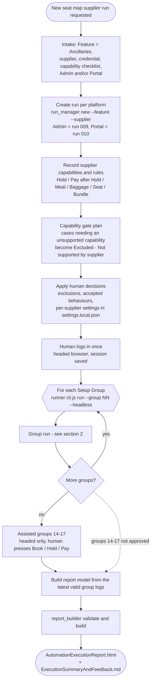
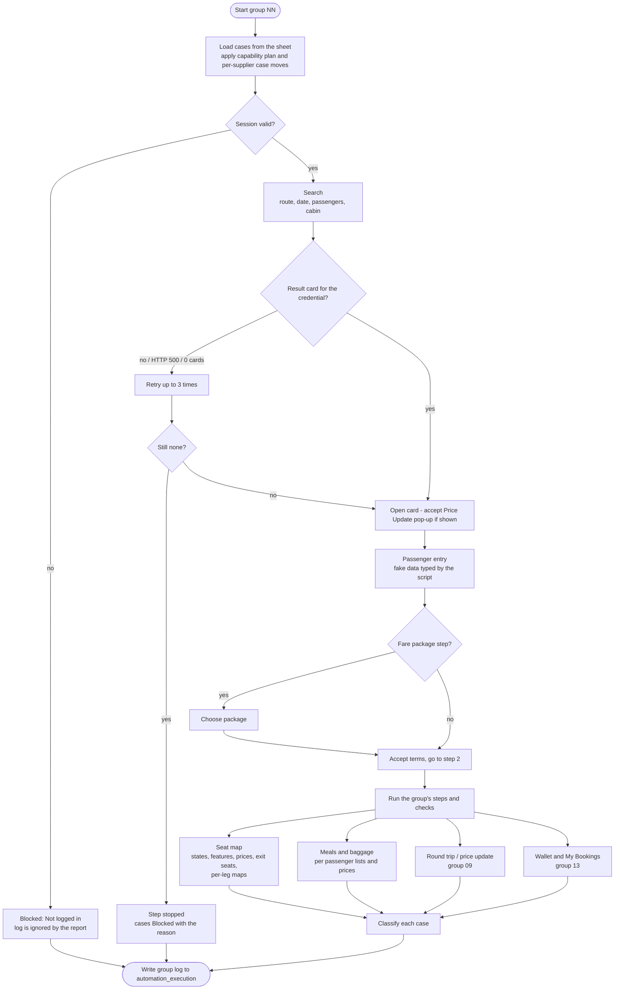
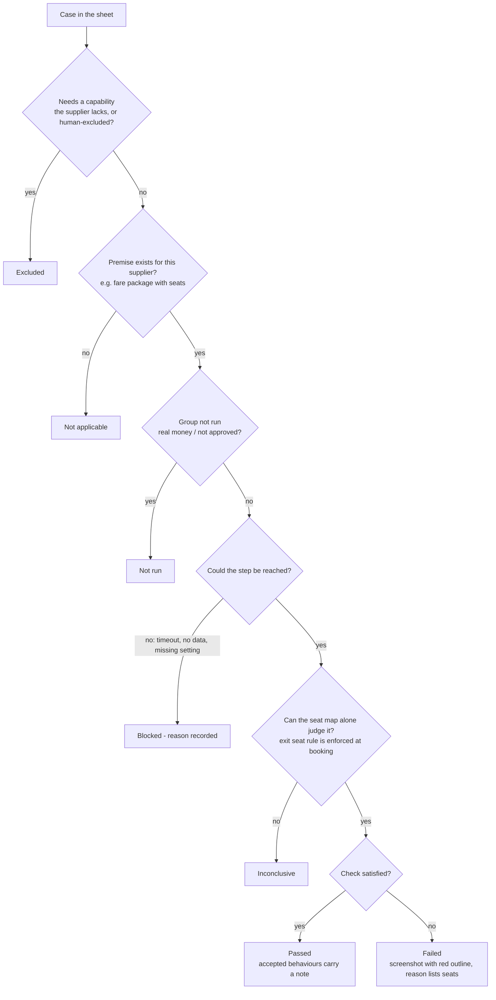
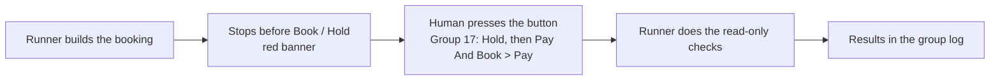

# Seat Map Run Flow — Ancillaries Supplier Run (Runner)

Mermaid diagrams: open the Markdown preview in VS Code (needs a Mermaid-capable preview) or paste into https://mermaid.live.

## 1. End to end

## 2. One Setup Group

## 3. How each case gets its status

## 4. Assisted groups 14–17 (headed only)

